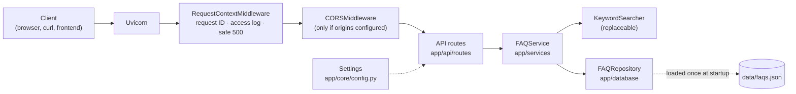

# AI Customer Support Chatbot

A backend API for an AI-powered customer support chatbot that businesses can embed into their websites. It is built with FastAPI and designed to grow in stages, from a well-tested foundation to a production-ready assistant that answers customer questions from each client's own knowledge base.

> **Current status: Stage 2 (FAQ knowledge base) is complete.**
> The API serves a validated FAQ knowledge base with listing, category filtering, pagination and **keyword** search.
> **No AI features are operational yet.** Search is deterministic keyword matching, not semantic or AI search. The API does not accept chat messages, call a language model or generate answers. Those are planned for later stages (see [Roadmap](#development-roadmap)).

---

## Contents

- [Overview](#overview)
- [Implementation status](#implementation-status)
- [Planned features](#planned-features)
- [Technology stack](#technology-stack)
- [Architecture](#architecture)
- [Prerequisites](#prerequisites)
- [Setup on Windows](#setup-on-windows)
- [Configuration](#configuration)
- [Running the API](#running-the-api)
- [API reference](#api-reference)
- [Running tests](#running-tests)
- [Logging](#logging)
- [Performance and deployment](#performance-and-deployment)
- [Development roadmap](#development-roadmap)
- [Troubleshooting](#troubleshooting)

---

## Overview

### Purpose

Small and medium-sized businesses often answer the same customer questions repeatedly: order status, returns, pricing, opening hours. This project aims to provide a support assistant that:

- answers common questions instantly, around the clock;
- bases its answers on the business's own documents (FAQs, policies, product information) rather than generic knowledge;
- can be added to an existing website with minimal effort;
- hands over to a human when it cannot help.

### Intended users

| User | What they get |
|------|---------------|
| **Business owners and support teams** | A chatbot on their website that reduces repetitive support work |
| **Website visitors and customers** | Fast answers to common questions without waiting for an agent |
| **Developers and freelancers** | A clean, documented, tested codebase to customise and deploy for clients |

---

## Implementation status

### Implemented

**Stage 2: FAQ knowledge base**

| Area | Details |
|------|---------|
| FAQ data | 30 fictional e-commerce FAQs in `data/faqs.json` (replaceable via `FAQ_DATA_PATH`), validated on startup |
| Validation | Pydantic models reject blank text, bad IDs, unknown categories, invalid keywords, duplicate IDs; the app refuses to start on bad data |
| Repository | Loads the JSON once with specific errors for missing files, malformed JSON, invalid records and duplicates |
| Keyword search | Deterministic, explainable scoring (exact question first, then keywords and words); a baseline for future semantic search |
| FAQ endpoints | List (with category filter and pagination), categories, search, get by ID; inactive FAQs are never exposed |
| Error handling | 404 / 422 / 503 / 500 with no internal paths or stack traces in responses; control characters escaped in logs |

**Stage 1: Foundation**

| Area | Details |
|------|---------|
| FastAPI application | App factory (`create_app`), versioned routes under `/api/v1` |
| Endpoints | `GET /` (API information), `GET /api/v1/health` (health check) |
| API documentation | Swagger UI (`/docs`), ReDoc (`/redoc`), OpenAPI schema (`/openapi.json`); disabled in production |
| Configuration | Typed, validated settings via pydantic-settings and `.env`; invalid values stop startup |
| Security defaults | Secrets kept out of code and logs, `DEBUG` blocked in production, CORS closed by default, generic 500 responses |
| Logging | Standard `logging`, configurable level, one consistent format, per-request IDs, redaction of tokens and emails |
| Tests | 411 pytest tests, 100% line coverage, fully offline (network access is blocked during tests) |
| Tooling | Pinned dependencies, Ruff linting and formatting, Git-ready project files |

### Not yet implemented

- Chat endpoint and conversation handling
- Any language model (LLM) integration
- Semantic (meaning-based) search: current search matches words only, with no synonyms or stemming
- Document ingestion and retrieval-augmented generation (RAG)
- Database and conversation history
- User interface (Streamlit or React)
- Authentication, rate limiting, Docker and deployment

The `frontend/` folder is a placeholder for these later stages. `app/database/` currently holds the JSON-backed FAQ repository; no SQL database is used.

---

## Planned features

These are goals, not current functionality.

- **AI chat:** natural-language answers to customer questions via a `/chat` endpoint
- **Knowledge-base answers (RAG):** answers grounded in each client's documents, with fewer made-up responses
- **Conversation memory:** context kept across messages in a session
- **Human handover:** escalation when the assistant cannot answer confidently
- **Admin interface:** upload and manage knowledge-base documents
- **Embeddable widget:** a React chat widget that clients add to their site with a script tag
- **Multi-client support:** separate configuration and knowledge per business
- **Production readiness:** authentication, rate limiting, monitoring, Docker deployment

---

## Technology stack

### In use now

| Purpose | Technology |
|---------|------------|
| Language | Python 3.11+ (developed and tested on 3.13) |
| Web framework | [FastAPI](https://fastapi.tiangolo.com/) |
| ASGI server | [Uvicorn](https://www.uvicorn.org/) |
| Data validation | [Pydantic v2](https://docs.pydantic.dev/) |
| Configuration | [pydantic-settings](https://docs.pydantic.dev/latest/concepts/pydantic_settings/) + python-dotenv |
| Testing | pytest, pytest-cov, FastAPI `TestClient` (httpx) |
| Code quality | [Ruff](https://docs.astral.sh/ruff/) (lint + format) |

### Installed for Stage 3 (not yet used by application code)

| Purpose | Technology |
|---------|------------|
| Sentence embeddings | [sentence-transformers](https://www.sbert.net/) with the `all-MiniLM-L6-v2` model (384-dimensional vectors), running locally on the CPU |
| Numerical arrays | NumPy |
| Model runtime | PyTorch (CPU build, installed as a dependency of sentence-transformers) |

### Planned (not installed)

| Purpose | Candidates |
|---------|------------|
| Language model | OpenAI API or another LLM provider |
| Vector database | e.g. Chroma, once the knowledge base outgrows in-memory search |
| Frontend | Streamlit (prototype), then React |

---

## Architecture

### Request flow



### Layers

| Layer | Folder | Responsibility | Status |
|-------|--------|----------------|--------|
| Entry point | `app/main.py` | Builds and configures the app | Implemented |
| API | `app/api/routes/` | HTTP only: parse requests, return responses | Implemented |
| Models | `app/models/` | Request and response schemas | Implemented |
| Core | `app/core/` | Settings, logging, middleware | Implemented |
| Services | `app/services/` | FAQ rules (active-only, pagination) and keyword search, independent of HTTP | Implemented |
| Database | `app/database/` | Loads and validates the FAQ JSON file (no SQL database yet) | Implemented |

Routes stay thin and delegate to services. The FAQ service is built once in `create_app()` and handed to routes with FastAPI's `Depends`; the search strategy sits behind a `FAQSearcher` interface so a semantic searcher can replace it later without touching the HTTP layer.

### Project structure

```
ai-customer-support-chatbot/
├── app/
│   ├── __init__.py            # Package version (__version__)
│   ├── main.py                # create_app() factory and ASGI app
│   ├── api/
│   │   ├── dependencies.py    # get_faq_service (FastAPI dependency)
│   │   ├── errors.py          # 422 logging, 503 for FAQ data failures
│   │   └── routes/
│   │       ├── health.py      # GET /api/v1/health
│   │       └── faqs.py        # GET /api/v1/faqs, /categories, /search, /{faq_id}
│   ├── core/
│   │   ├── config.py          # Typed settings from environment / .env
│   │   ├── logging_config.py  # Logging setup and redaction
│   │   └── middleware.py      # Request ID, access log, safe 500 handler
│   ├── models/
│   │   ├── faq.py             # FAQ model, validation rules, API response models
│   │   ├── health.py          # HealthResponse
│   │   └── root.py            # RootResponse
│   ├── services/
│   │   ├── faq_service.py     # Active-only rules, categories, pagination
│   │   └── faq_search.py      # KeywordSearcher and the FAQSearcher interface
│   └── database/
│       └── faq_repository.py  # Load/validate data/faqs.json, typed loading errors
├── frontend/                  # (later stages) Streamlit, then React
├── data/
│   └── faqs.json              # Sample FAQ knowledge base (fictional store; replaceable)
├── tests/                     # pytest suite
├── .env.example               # Documented example configuration
├── requirements.txt           # Pinned, tested dependencies
├── pyproject.toml             # Project metadata, pytest and Ruff settings
└── README.md
```

---

## Prerequisites

| Requirement | Notes |
|-------------|-------|
| Windows 10 or 11 | Instructions use PowerShell. macOS/Linux work with equivalent commands |
| Python 3.11 or newer | 3.13 recommended. Check with `py --version` |
| Git | Check with `git --version` |
| VS Code (optional) | With the Python extension |

No API keys or internet services are needed to run the current stage.

---

## Setup on Windows

Run all commands in **PowerShell** from the project root.

### 1. Get the code

```powershell
git clone https://github.com/<your-username>/ai-customer-support-chatbot.git
cd ai-customer-support-chatbot
```

### 2. Create a virtual environment

```powershell
py -3.13 -m venv .venv
```

This creates an isolated Python environment in `.venv/`, so project packages don't affect other projects. Use `py -3.11` or `py -3.12` if that is the version you have.

### 3. Activate the virtual environment

```powershell
.\.venv\Scripts\Activate.ps1
```

Your prompt should now start with `(.venv)`. Activate it in every new terminal before working on the project.

| Shell | Activation command |
|-------|--------------------|
| PowerShell | `.\.venv\Scripts\Activate.ps1` |
| Command Prompt (cmd) | `.venv\Scripts\activate.bat` |
| Git Bash | `source .venv/Scripts/activate` |

To deactivate, run `deactivate`.

**VS Code:** press `Ctrl+Shift+P`, choose **Python: Select Interpreter**, and pick `.venv\Scripts\python.exe`. New terminals will then activate it automatically.

### 4. Install dependencies

```powershell
python -m pip install --upgrade pip
pip install -r requirements.txt
```

`requirements.txt` pins exact versions that have been tested together, so every machine installs the same setup.

> **Large download:** the semantic-search dependencies include PyTorch, so the first install downloads several hundred MB and the virtual environment grows to about **1 GB**. On Windows the PyPI build of PyTorch is CPU-only; no GPU is needed.

### 5. Configure the environment

```powershell
Copy-Item .env.example .env
```

The defaults work as-is for local development. See [Configuration](#configuration) to change them.

---

## Configuration

Settings are defined in [app/core/config.py](app/core/config.py) using pydantic-settings. Every variable is optional, and the defaults are safe for local development.

### How values are loaded

Values are resolved in this order (highest priority first):

1. **Environment variables** set in the shell or on the server, e.g. `$env:APP_ENV = "staging"`
2. **`.env` file** in the project root. It is always found, whichever directory you run commands from.
3. **Defaults** defined in `Settings`

Variable names are case-insensitive. All values are validated at startup, so an invalid value (e.g. `APP_ENV=prod`) stops the app with a clear error instead of misbehaving later.

### Variables

| Variable | Default | Rules |
|----------|---------|-------|
| `APP_NAME` | `AI Customer Support Chatbot API` | 1–100 characters |
| `APP_ENV` | `development` | `development`, `staging` or `production`. Production disables the docs endpoints |
| `DEBUG` | `false` | `true` / `false`. Must be `false` in production |
| `LOG_LEVEL` | `INFO` | `DEBUG`, `INFO`, `WARNING`, `ERROR` or `CRITICAL` |
| `API_V1_PREFIX` | `/api/v1` | Starts with `/`, no trailing slash |
| `CORS_ORIGINS` | `[]` | JSON list of full origins, e.g. `["http://localhost:8501"]`. No `*` |
| `FAQ_DATA_PATH` | `data/faqs.json` | FAQ JSON file; relative paths resolve from the project root. The app will not start if it is missing or invalid |
| `EMBEDDING_MODEL_NAME` | `sentence-transformers/all-MiniLM-L6-v2` | Hugging Face model ID or local folder for semantic search (1–200 characters). See below |
| `SEMANTIC_INDEX_PRELOAD` | `false` | `true` builds the semantic FAQ index at startup instead of on first use. See below |
| `EMBEDDING_LOAD_RETRY_SECONDS` | `30` | After a failed model load, answer semantic requests with 503 + `Retry-After` for this many seconds before retrying (0–3600). See [Performance and deployment](#performance-and-deployment) |
| `SEMANTIC_MIN_SIMILARITY` | `0.40` | Default minimum cosine similarity (-1 to 1) for semantic search results. **Experimental**: see [Similarity thresholds](#similarity-thresholds) |
| `OPENAI_API_KEY` | *(unset)* | **Not used yet.** Optional, reserved for a later stage |

The application version is defined in code (`app/__init__.py`), not in the environment.

### Embedding model

- The model is **not** loaded when the app is imported or started; it is loaded the first time semantic search needs it. Importing `sentence-transformers` and PyTorch alone can take 10–30+ seconds, so ordinary startup and tests stay fast. A test enforces this.
- **First use downloads the model** from Hugging Face (about 90 MB for the default) into `%USERPROFILE%\.cache\huggingface`. Set `HF_HOME` to use another folder.
- After the first download the model works offline. Set `HF_HUB_OFFLINE=1` to forbid any download attempt, e.g. on a server.
- To use a different model, set `EMBEDDING_MODEL_NAME` to another sentence-transformers model ID or to a local folder containing a saved model.

### Semantic FAQ index

The question of every **active** FAQ is embedded once, in a single batch, and kept in memory (`app/services/semantic_search_service.py`). Searches reuse this index instead of re-embedding the FAQs.

| Mode | Startup | First semantic search |
|------|---------|-----------------------|
| `SEMANTIC_INDEX_PRELOAD=false` (default) | Fast (about a second) | Slow once: loads the model and builds the index (about 40–60 s on a typical laptop CPU) |
| `SEMANTIC_INDEX_PRELOAD=true` | The server accepts requests only after the index is built | Fast |

- Preloading runs in a worker thread, so it never blocks the event loop. If it fails (for example the model cannot be downloaded), the error is logged, the app still starts, and the index is retried on first use.
- The index is safe under concurrent requests: it is built at most once, and rebuilding swaps in a complete new index atomically.
- **Each worker process has its own model and index.** With `uvicorn --workers 4`, or several containers, every worker loads the model (roughly a few hundred MB of memory each) and builds its own index.

### Secrets

- **Never commit `.env`.** It is excluded by `.gitignore`. Only `.env.example`, which has no real values, is committed.
- **Never hardcode API keys** in source code. Set them in `.env` locally or as environment variables on the server.
- Secret settings use Pydantic's `SecretStr`, which displays as `**********` in output.
- At startup the app logs a summary that states *whether* a key is set, never its value.

---

## Running the API

With the virtual environment activated:

```powershell
uvicorn app.main:app --reload
```

`--reload` restarts the server when code changes. Use it in development only. The API is then available at:

| URL | Description |
|-----|-------------|
| http://127.0.0.1:8000/ | API information |
| http://127.0.0.1:8000/api/v1/health | Health check |
| http://127.0.0.1:8000/api/v1/faqs | FAQ list (see [API reference](#api-reference)) |
| `POST` http://127.0.0.1:8000/api/v1/semantic-search | Semantic FAQ search (JSON body; easiest to try from `/docs`) |
| http://127.0.0.1:8000/docs | Swagger UI: interactive docs where you can try requests |
| http://127.0.0.1:8000/redoc | ReDoc: readable reference documentation |
| http://127.0.0.1:8000/openapi.json | Machine-readable OpenAPI schema |

Stop the server with `Ctrl+C`. To use another port: `uvicorn app.main:app --reload --port 8001`.

---

## API reference

All responses are JSON. Every response includes an `X-Request-ID` header whose value also appears in the server logs (`req=...`), which helps trace a specific request.

### `GET /`

Returns basic information about the API.

```powershell
Invoke-RestMethod http://127.0.0.1:8000/
```

```json
{
  "message": "AI Customer Support Chatbot API",
  "version": "0.1.0"
}
```

### `GET /api/v1/health`

Reports that the service is running. Intended for uptime monitors, load balancers and deployment checks. It does no expensive work, so it is safe to call frequently.

```powershell
Invoke-RestMethod http://127.0.0.1:8000/api/v1/health
```

```json
{
  "status": "healthy",
  "service": "ai-customer-support-chatbot"
}
```

### FAQ endpoints

All FAQ endpoints are read-only and only ever return **active** FAQs. Public FAQ objects contain `id`, `question`, `answer` and `category`.

| Method | Path | Description |
|--------|------|-------------|
| `GET` | `/api/v1/faqs` | Active FAQs, paginated. Query: `category` (optional, case-insensitive), `offset` (default 0), `limit` (1–100, default 20) |
| `GET` | `/api/v1/faqs/categories` | Categories that contain at least one active FAQ, alphabetical |
| `GET` | `/api/v1/faqs/search` | Keyword search. Query: `q` (required, 1–200 characters), `limit` (1–50, default 5) |
| `GET` | `/api/v1/faqs/{faq_id}` | One active FAQ (ID is case-insensitive); `404` if missing or inactive |

```powershell
Invoke-RestMethod "http://127.0.0.1:8000/api/v1/faqs?category=shipping&limit=2"
```

```json
{
  "count": 2,
  "total": 6,
  "offset": 0,
  "limit": 2,
  "faqs": [
    { "id": "faq_006", "question": "How long does delivery take?", "answer": "Standard delivery usually takes ...", "category": "shipping" },
    { "id": "faq_007", "question": "How much does shipping cost?", "answer": "Shipping costs depend on ...", "category": "shipping" }
  ]
}
```

To page through results, repeat the request with `offset` increased by `limit` until `offset + count >= total`.

```powershell
Invoke-RestMethod "http://127.0.0.1:8000/api/v1/faqs/search?q=track+order&limit=1"
```

```json
{
  "query": "track order",
  "count": 1,
  "results": [
    {
      "id": "faq_001",
      "question": "How can I track my order?",
      "answer": "You can track your order from the My Orders section ...",
      "category": "orders",
      "score": 25,
      "reasons": ["keyword 'track' in query (+15)", "question words: order, track (+10)"]
    }
  ]
}
```

Search is **keyword matching**, not AI: results are ranked by fixed, explainable rules (an exact question match always ranks first), and `reasons` shows which rules matched. A query with no matches returns `200` with empty `results`.

### `POST /api/v1/semantic-search`

Finds FAQs whose question is closest in **meaning** to the query, using sentence embeddings (`all-MiniLM-L6-v2`, running locally). Unlike keyword search, it can match "when will my stuff arrive" to *How long does delivery take?* with no words in common. Only active FAQs are searched, and answers are the stored FAQ answers, returned verbatim. Nothing is generated.

| Field | Type | Required | Rules |
|-------|------|----------|-------|
| `query` | string | yes | 1–1000 characters after whitespace is collapsed |
| `top_k` | integer | no (default 5) | 1–50 |
| `category` | string or `null` | no | Any FAQ category, case-insensitive |
| `min_similarity` | number or `null` | no | -1 to 1; only results scoring at least this value are returned. Omit or `null` uses the server default (`SEMANTIC_MIN_SIMILARITY`, initially 0.40); `-1` disables the threshold |

```powershell
Invoke-RestMethod -Method Post -Uri http://127.0.0.1:8000/api/v1/semantic-search `
  -ContentType "application/json" `
  -Body '{"query": "I can''t log in", "top_k": 2, "min_similarity": 0.4}'
```

```json
{
  "query": "I can't log in",
  "min_similarity": 0.4,
  "results": [
    {
      "faq_id": "faq_027",
      "question": "How do I reset my password?",
      "answer": "Select Sign In, then Forgot Password, and enter the email address on your account. ...",
      "category": "account",
      "similarity_score": 0.5305
    }
  ],
  "total_results": 1
}
```

`similarity_score` is the **cosine similarity** between the query and the FAQ question, from -1 to 1 and rounded to 4 decimal places. It is a relative ranking signal, **not a probability or confidence percentage** (see [Similarity thresholds](#similarity-thresholds)).

The response's `min_similarity` is the threshold that was **actually applied**: the request value, or the server default if the request left it out. If no FAQ reaches it, `results` is an empty list. The API never substitutes the "closest" FAQ, never returns an unrelated FAQ as a fallback, and never generates an answer.

**First request:** loading the model and building the index happens on the first semantic search, which can take from under a minute to a couple of minutes on a laptop CPU. Many HTTP clients and proxies time out before that, so set `SEMANTIC_INDEX_PRELOAD=true` for anything other than local development. Later searches take tens of milliseconds. Other endpoints stay responsive during the load.

### Similarity thresholds

A threshold decides when the closest FAQ is *close enough* to show. Below it, the API returns no result rather than a wrong answer.

**Cosine similarity is not confidence.** A score of `0.62` does not mean "62% likely to be correct", and `0.9` is not "twice as sure" as `0.45`. Cosine similarity measures how closely two sentence vectors point in the same direction. Its scale depends on the model, the wording and length of the FAQ questions, and even the length of the query: a one-word query like "track" scored only 0.39 against the right FAQ, while a wrong match scored 0.47. Scores are useful for **ranking** results and for a **tuned cut-off**, but they are not calibrated probabilities. Turning them into a real confidence would require calibration against labelled data, which this project does not do yet.

**The default, `SEMANTIC_MIN_SIMILARITY=0.40`, is an experimental starting point, not a validated production value.** Callers can override it per request with `min_similarity` (-1 to 1).

#### How to tune the threshold

1. **Collect real evaluation questions.** Gather a few hundred real customer messages (from support emails, chat logs or the search box), with personal data removed. Include questions the FAQs *should* answer and questions they *cannot* answer (off-topic or not covered).
2. **Label them.** For each question, record the correct FAQ ID, or "none" if no FAQ answers it.
3. **Score them.** Run every question through semantic search with `"min_similarity": -1` and `"top_k": 1`, and record the top result's ID and score.
4. **Sort each question into a group:** *correct* (top result is the labelled FAQ), *wrong* (a different FAQ), or *should be empty* (labelled "none").
5. **Try candidate thresholds** (for example every 0.05 from 0.30 to 0.70). For each, count the correct answers kept (the coverage you keep), the wrong answers still shown, and the "none" questions that still get an answer.
6. **Choose the trade-off for the business.** For customer support, showing a wrong answer is usually worse than showing none, so favour fewer wrong answers even at some loss of coverage.
7. **Re-tune whenever the model, the FAQ content or the kind of customer traffic changes.** A threshold tuned for one dataset does not carry over to another.

**Worked example (illustration only, far too few questions to decide anything):** the 17 keyword-baseline queries from Stage 2 plus 6 off-topic questions, against the sample FAQs with the default model:

| Threshold | Correct answers kept | Wrong answers shown | Off-topic questions answered |
|-----------|----------------------|---------------------|------------------------------|
| 0.30 | 15 / 15 | 2 / 2 | 2 / 6 |
| 0.35 | 15 / 15 | 2 / 2 | 0 / 6 |
| **0.40 (default)** | 14 / 15 | 2 / 2 | 0 / 6 |
| 0.50 | 14 / 15 | 0 / 2 | 0 / 6 |
| 0.60 | 12 / 15 | 0 / 2 | 0 / 6 |

Here 0.40 stops every off-topic question and drops only the one-word query "track" (0.39), but still shows two wrong matches ("my package is late" 0.47, "send it back" 0.47), which a higher threshold would hide. With real evaluation data the picture can look quite different; decide using your own numbers.

When nothing passes the threshold, the API simply returns no results. Fallback behaviour (keyword search, asking a clarifying question, handing over to a human or using a language model) is planned for a later stage and is **not** part of this one.

### Documentation endpoints

| Method | Path | Returns |
|--------|------|---------|
| `GET` | `/docs` | Swagger UI (HTML) |
| `GET` | `/redoc` | ReDoc (HTML) |
| `GET` | `/openapi.json` | OpenAPI 3 schema (JSON) |

These return `404` when `APP_ENV=production`, so the full API map is not exposed publicly.

### Errors

| Status | When | Body |
|--------|------|------|
| `404` | Unknown path | `{"detail": "Not Found"}` |
| `404` | Unknown or inactive FAQ ID | `{"detail": "FAQ not found"}` |
| `422` | Invalid parameter or request body (empty `q`/`query`, unknown `category`, bad `limit`/`offset`/`top_k`/`min_similarity`, unknown body fields) | FastAPI's standard list of field errors |
| `503` | FAQ data unavailable while serving a request | `{"detail": "The FAQ knowledge base is temporarily unavailable.", "request_id": "<id>"}` |
| `503` | Embedding model could not be loaded, or produced unusable vectors | `{"detail": "Semantic search is temporarily unavailable.", "request_id": "<id>"}` |
| `500` | Unexpected server error | `{"detail": "Internal server error", "request_id": "<id>"}` |

Internal error details are written to the server log only, never returned to the client.

---

## Running tests

With the virtual environment activated, from the project root:

```powershell
pytest                                       # run all tests
pytest -v                                    # list each test
pytest tests/test_health.py                  # run one file
pytest --cov=app --cov-report=term-missing   # with a coverage report
```

The suite currently has **411 tests with 100% line coverage**, and runs in about 20 seconds.

| File | Covers |
|------|--------|
| `test_root.py` | `GET /` status and response |
| `test_health.py` | Health endpoint status, structure and routing |
| `test_docs.py` | OpenAPI schema, Swagger UI, ReDoc; disabled in production |
| `test_config.py` | Defaults, `.env` and environment loading, validation, secret masking |
| `test_logging.py` | Levels, format, handler count, redaction |
| `test_app.py` | Request IDs, safe 500 errors, CORS |
| `test_isolation.py` | Proves tests cannot reach the internet |
| `test_faq_models.py` | FAQ validation and normalisation rules |
| `test_faq_repository.py` | Loading, all loading errors, lookups and category filters |
| `test_faq_search.py` | Keyword scoring rules, ordering and determinism |
| `test_faq_service.py` | Active-only rules, categories, pagination, search behaviour, Stage 3 baseline |
| `test_faq_api.py` | FAQ endpoints, pagination, validation errors, route ordering |
| `test_dependencies.py` | FAQ data loaded once per app; test injection |
| `test_error_handling.py` | 404/422/503/500 responses and safe diagnostic logging |
| `test_faq_data.py` | The bundled sample `data/faqs.json` (marked `sample_data`) |

Tests are fully isolated:

- They never call external APIs. Any attempt to reach a non-local host fails the test.
- They ignore your local `.env` and shell variables, so results are the same on every machine.
- `TestClient` calls the app in-process. No server needs to be running.
- FAQ tests use a small fixed dataset written to a temporary file, not `data/faqs.json`.

### Real embedding model tests (opt-in)

Ordinary tests never load the real model: they use fake encoders with fixed or hand-chosen vectors. To guarantee this, the test session forces Hugging Face offline mode (`HF_HUB_OFFLINE=1`) and **fails if any ordinary test imports PyTorch or sentence-transformers**.

Tests that load the real model are marked `embedding_model`. They run only when you ask **and** the model is already downloaded; they never download it:

```powershell
$env:RUN_EMBEDDING_MODEL_TESTS = "1"; pytest -m embedding_model; Remove-Item Env:RUN_EMBEDDING_MODEL_TESTS
```

They take about a minute. If the model is not in the local cache, they are skipped with a message saying so. To download it once, run a semantic search against the app, or run `python scripts/evaluate_semantic_search.py` without `--offline`.

### Evaluating semantic search quality

`data/semantic_search_eval.json` holds 50 labelled questions for the sample FAQs. Each is one of: exact wording, paraphrase, synonym, short, long, typo, ambiguous (several acceptable FAQs), or out of scope (no FAQ should be returned). Every expected ID is an active FAQ in `data/faqs.json`, and a test enforces this.

```powershell
python scripts/evaluate_semantic_search.py                      # threshold from SEMANTIC_MIN_SIMILARITY
python scripts/evaluate_semantic_search.py --threshold 0.5      # try another threshold
python scripts/evaluate_semantic_search.py --offline --output eval_results.json
```

The script searches every question **without** a threshold, then applies the threshold as a separate step, so it can tell two kinds of failure apart:

| Report line | Meaning |
|-------------|---------|
| Top-1 accuracy | In-scope questions whose first result is an acceptable FAQ (threshold ignored) |
| Recall@3 | In-scope questions with an acceptable FAQ anywhere in the top 3 |
| Answered correctly | Correct first result **and** score at or above the threshold: what users actually get |
| Threshold rejections | Right FAQ ranked first, but its score is below the threshold, so no answer is returned |
| Wrong answer shown / hidden | **Retrieval failure**: a wrong FAQ ranked first, and either passed the threshold (shown to the user) or not |
| No-match rejection rate | Out-of-scope questions whose best score stayed below the threshold |
| Latency | Per-query search time after a warm-up; the one-off model load and index build are reported separately |

Results are reproducible: the report records the model, threshold, k and SHA-256 hashes of both data files, and two runs on the same machine gave identical rankings, scores and metrics. Only the timings vary between runs.

**Baseline** (`all-MiniLM-L6-v2`, threshold 0.40, 43 in-scope and 7 out-of-scope questions):

| Metric | Result |
|--------|--------|
| Top-1 accuracy | 86.0% (37 / 43) |
| Recall@3 | 95.3% (41 / 43) |
| Answered correctly | 83.7% (36 / 43) |
| Threshold rejections | 1 ("i forgott my pasword": correct, but 0.35) |
| Wrong answer shown | 5 (e.g. "How many days until my parcel shows up?" ranked *tracking says delivered* above *How long does delivery take?*) |
| No-match rejection rate | 71.4% (5 / 7); "Are you hiring?" (0.42) and "price matching" (0.41) were answered |
| Median latency | about 50 ms per query on a laptop CPU |

Weakest areas: short queries (4 of 6 top-1) and heavy typos ("how do i trak my ordr" found nothing relevant). The 0.40 threshold lets two off-topic questions through while rejecting one correct answer, which is another sign it needs tuning on real questions.

**Rules for the evaluation set:** labels are written before looking at results and must not be changed to raise a score. Fix a label only if it is genuinely wrong (and say why in the commit). Add new cases instead, especially real customer questions. When FAQs change, update the labels, which the label test enforces.

### Using client-specific FAQ data

After replacing `data/faqs.json` with a client's FAQs, skip the checks that are specific to the bundled sample:

```powershell
pytest -m "not sample_data"
```

### Code quality

```powershell
ruff check .      # lint
ruff format .     # auto-format
```

---

## Logging

Logging uses Python's standard `logging` module, configured in [app/core/logging_config.py](app/core/logging_config.py).

```
2026-10-10 22:28:19,652 | INFO     | app.request | req=95389afc4a29... | GET /api/v1/health -> 200 (50.7 ms)
```

- **Format:** timestamp, level, logger name, request ID and message. Uvicorn's own messages use the same format.
- **Level:** controlled by `LOG_LEVEL`.
- **No duplicates:** a single handler on the root logger. Reconfiguring never repeats output.
- **Sensitive data:** requests are logged by path only, without query strings, headers or bodies. As a safety net, bearer tokens, API keys, `password=`/`token=` values and email addresses are redacted from every line, including tracebacks.
- **In new modules:** use `logger = logging.getLogger(__name__)`.

---

## Performance and deployment

### What happens when

| Moment | Work done | Typical cost (laptop CPU) |
|--------|-----------|---------------------------|
| `import app.main` / app start | Load and validate the FAQ JSON. **No model is imported or downloaded** (a test enforces this) | ~1–3 s |
| First semantic search (or startup with `SEMANTIC_INDEX_PRELOAD=true`) | Import PyTorch + sentence-transformers, load the model (download once if not cached), embed every active FAQ question in **one batch**, prepare the index | ~30–140 s, mostly the library import |
| Every later semantic search | Embed the query only, then one matrix-vector product against the cached index | ~20–50 ms |
| Keyword search, FAQ listing, health | No model involved | a few ms |

The model and the index are kept in memory and reused by every request. They are built once per process and never per request. Concurrent first requests wait for a single build.

### Memory

Measured for one process on Windows with the default model and the 30 sample FAQs:

| Stage | Working set (RAM in use) | Private (committed) |
|-------|--------------------------|---------------------|
| App started, FAQs loaded, no model | ~50 MB | ~140 MB |
| PyTorch + sentence-transformers imported | ~390 MB | ~560 MB |
| Model loaded | ~500 MB | ~690 MB |
| Index built (29 FAQs) | ~520 MB | ~710 MB |

Plan for **roughly 0.5–0.75 GB per process** once semantic search has been used. The libraries and model account for almost all of it; the FAQ index itself is tiny (29 × 384 × 4 bytes ≈ 44 KB, plus a float64 copy used for scoring).

**How the index grows.** Memory is about 4.5 KB per FAQ (float32 plus float64 rows), and scoring is one matrix-vector product. A synthetic benchmark of the scoring step alone:

| FAQs | Index memory | Scoring time per search |
|------|--------------|-------------------------|
| 30 | < 0.2 MB | ~0.03 ms |
| 1,000 | ~4.5 MB | ~0.3 ms |
| 10,000 | ~45 MB | ~2.6 ms |
| 100,000 | ~450 MB | ~33 ms |

So an in-memory matrix is comfortably sufficient for a support FAQ (hundreds to a few thousand entries). A vector database only becomes worth its complexity at much larger scale or when several processes must share one index. Neither applies yet.

### Development (`--reload`) vs production (workers)

| | Development | Production |
|---|-------------|------------|
| Command | `uvicorn app.main:app --reload` | `uvicorn app.main:app --host 0.0.0.0 --port 8000 --workers 2` (no `--reload`) |
| Processes | One reloader plus **one** worker, restarted on every code change | N independent worker processes |
| Model and index | Lost on every restart; rebuilt on the next semantic search (keep `SEMANTIC_INDEX_PRELOAD=false` so restarts stay fast) | Each worker loads its **own** model and builds its **own** index: N × memory, N × startup cost |
| Recommended | `SEMANTIC_INDEX_PRELOAD=false` | `SEMANTIC_INDEX_PRELOAD=true`, so a worker accepts requests only once ready and no customer waits for the first load |

Sizing guidance for production:

- **Memory:** `workers × ~0.75 GB` plus headroom. A 2 GB server comfortably runs 1–2 workers.
- **CPU:** PyTorch uses several CPU threads *per process* for each embedding. With many workers on few cores they compete; on small servers prefer fewer workers, or limit threads per worker by setting `OMP_NUM_THREADS` (e.g. `2`) in the environment.
- **Requests inside one worker:** FastAPI runs the synchronous semantic search handler in its thread pool, so slow embeddings never block the event loop and other endpoints stay responsive. The model is shared by all threads in that worker.
- `--workers` works with uvicorn on Windows and Linux. Gunicorn is Linux/macOS only.

### When the model cannot be loaded

- The app still starts; FAQ listing, keyword search and health keep working.
- Semantic search returns **503** `{"detail": "Semantic search is temporarily unavailable.", ...}`. Details (model name, cause) go to the server log only.
- After a failed load the service waits `EMBEDDING_LOAD_RETRY_SECONDS` (default 30) before trying again. Until then, semantic requests fail immediately with a `Retry-After` header, instead of each queued request repeating a slow failing download. After the cooldown, the next request retries, and success clears the cooldown.
- Use `HF_HUB_OFFLINE=1` on servers where the model is pre-installed and downloads must never happen.

## Development roadmap

The roadmap is indicative; scope and order may change as the project evolves.

| Stage | Focus | Status |
|-------|-------|--------|
| **1. Foundation** | FastAPI structure, configuration, logging, tests, Git setup | **Complete** |
| **2. FAQ knowledge base** | FAQ models, JSON repository, keyword search baseline, FAQ REST API | **Complete** |
| **3. Semantic search (RAG)** | Embeddings, vector search, comparison against the keyword baseline | Planned |
| **3b. AI chat** | `/chat` endpoint, LLM integration grounded in retrieved FAQs | Planned |
| **4. Conversations and storage** | Database, session history, conversation memory | Planned |
| **5. Streamlit frontend** | Chat UI and simple admin page for testing and demos | Planned |
| **6. React widget** | Embeddable chat widget for client websites | Planned |
| **7. Production readiness** | Authentication, rate limiting, Docker, deployment, monitoring | Planned |

---

## Troubleshooting

| Problem | Solution |
|---------|----------|
| `Activate.ps1 cannot be loaded because running scripts is disabled` | Run once: `Set-ExecutionPolicy -Scope CurrentUser RemoteSigned` |
| `py` is not recognised | Install Python from [python.org](https://www.python.org/downloads/) with the **py launcher** option, or use `python` instead |
| `ModuleNotFoundError: No module named 'fastapi'` | The virtual environment is not active. Activate it and reinstall with `pip install -r requirements.txt` |
| `ModuleNotFoundError: No module named 'app'` | Run commands from the project root, not from inside `app/` or `tests/` |
| App stops with a `ValidationError` on startup | A value in `.env` or the environment is invalid. The message names the variable; compare with `.env.example` |
| Port 8000 is already in use | Start on another port: `uvicorn app.main:app --reload --port 8001` |
| `/docs` returns 404 | `APP_ENV` is set to `production`. Use `development` locally |
| `huggingface_hub ... cache-system uses symlinks ... your machine does not support them` warning | Harmless on Windows: the model cache works but uses a little more disk space. Enable Windows Developer Mode to allow symlinks, or set `HF_HUB_DISABLE_SYMLINKS_WARNING=1` to hide the warning |
| First semantic search is slow | The model is being downloaded and loaded (one-off). Later calls reuse it |
| App stops with `Cannot start: FAQ knowledge base failed to load` | `FAQ_DATA_PATH` points to a missing or invalid file. The log line names the error type, file and failing records |
