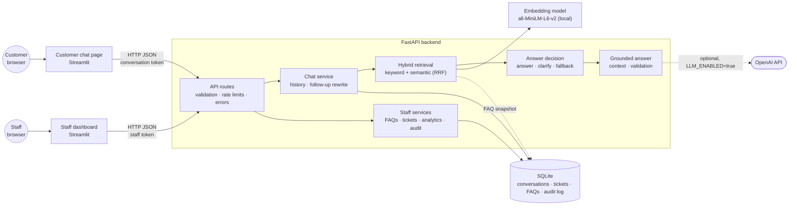
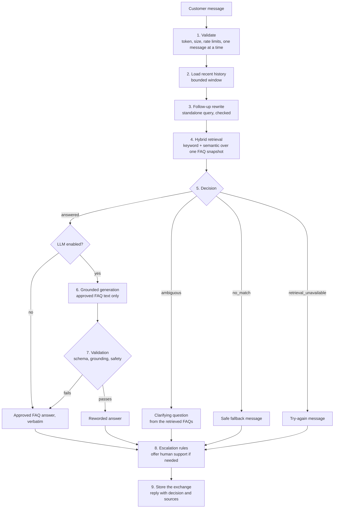

# AI Customer Support Chatbot

A customer support assistant that answers questions only from a business's approved FAQ content, with semantic and keyword retrieval, optional LLM rewording that is validated against the source, human support requests and a staff dashboard.

Built with FastAPI, Streamlit, SQLite and a locally run sentence-embedding model. OpenAI is optional and off by default.

> **Project status.** Development stages 1–13 are implemented. The application runs locally and as a Docker Compose deployment that has been built and tested on Docker. It is **not yet ready for public production**: staff authentication is a prototype, and deployment steps such as a trusted certificate, off-server backups and alerting have not been carried out on a real server ([readiness assessment](docs/deployment-readiness.md#current-status-end-of-stage-13)).

## Contents

1. [Project overview](#project-overview)
2. [Key features](#key-features)
3. [Technology stack](#technology-stack)
4. [System architecture](#system-architecture)
5. [AI answer workflow](#ai-answer-workflow)
6. [Screenshots](#screenshots)
7. [Installation](#installation)
8. [Configuration](#configuration)
9. [Running the application](#running-the-application)
10. [Docker setup](#docker-setup)
11. [Testing and evaluation](#testing-and-evaluation)
12. [Security](#security)
13. [Known limitations](#known-limitations)
14. [Project roadmap](#project-roadmap)
15. [Documentation](#documentation)
16. [License](#license)
17. [Author](#author)

---

## Project overview

**What it does.** Customers ask questions in a chat page. The backend finds the matching answer in the business's FAQ knowledge base and replies with it, citing the FAQ it came from. When no FAQ fits, it says so instead of guessing; when several fit, it asks a clarifying question. Customers can ask follow-up questions, request help from a person, and check the status of that request. Staff manage the FAQs, work the support tickets and review analytics in a separate dashboard.

**Who it is for.** Small and medium-sized businesses that answer the same questions repeatedly (orders, returns, accounts, pricing), and developers who want a documented, tested starting point for such an assistant. The repository ships with a sample knowledge base for a fictional online store ([data/faqs.json](data/faqs.json), 30 FAQs).

**The business problem.** Repetitive questions take support staff time, while a general-purpose chatbot can give confident answers that the business never approved: an invented refund rule or delivery promise becomes the company's problem.

**How AI is used.**

- **Sentence embeddings** (`all-MiniLM-L6-v2`, run locally on the CPU) find FAQs that mean the same as the customer's question, even in different words.
- **Hybrid retrieval** combines that semantic ranking with keyword search.
- **A language model (optional)** may reword an approved answer so it addresses the question directly, and may rewrite a follow-up question ("what about after 30 days?") into a standalone one. It never chooses the answer and never adds facts.

**Why grounded retrieval matters.** The decision to answer is made by retrieval rules over approved content, not by the language model. When the model is enabled, it receives only the approved FAQ text as evidence, and its reply is validated for unsupported claims; if validation fails, the approved FAQ answer is returned word for word. Conversation history helps interpret follow-ups but is never treated as a source of facts. The result is an assistant whose answers can always be traced to content the business wrote.

## Key features

All of the following are implemented and covered by automated tests.

**Retrieval and answers**

- **Keyword FAQ search** with normalised, cached FAQ text.
- **Semantic FAQ search** with an in-memory embedding index of the FAQ questions.
- **Hybrid retrieval** combining keyword and semantic rankings with Reciprocal Rank Fusion.
- **Answer decisions:** answer with an approved FAQ, ask a clarifying question, or return a safe fallback message; keyword-only answers when the embedding model is unavailable and the keyword evidence is strong.
- **Grounded LLM answers (optional):** OpenAI rewords the approved answer using only the retrieved FAQ text; replies are validated, and any failure returns the approved answer verbatim. Timeouts, bounded retries and a circuit breaker protect against provider outages.

**Conversations**

- **Conversation sessions** with a secret access token (stored only as a hash) and a 60-minute default lifetime.
- **Stored conversation history** in SQLite, with bounded context windows.
- **Contextual follow-up questions,** rewritten into standalone queries by rules or by the LLM, with checks that the rewrite adds nothing the customer did not say.
- **Safe retries:** each message has a client ID, so a retried send is answered once; one message per conversation is processed at a time.

**Customer chat page (Streamlit)**

- Chat with source references, clear states for loading, errors and service availability.
- **Human support requests and sales inquiries** with explicit consent, offered by fixed rules (for example when a customer asks for a person) or from the sidebar.
- **Support ticket tracking** by reference number, scoped to the customer's own conversation.

**Staff dashboard (Streamlit)**

- **FAQ management:** create, edit and deactivate FAQs with version checks and a full revision history; edits reach retrieval consistently without a restart.
- **Support tickets:** a status workflow, assignment to staff, internal notes and reference search.
- **Basic analytics** from stored data (conversations, answer decisions, tickets, response times) with date filters, and **service monitoring** (request rates, errors, latency per stage, failures).
- **Two roles,** `admin` and `support`, enforced by the backend, and an append-only **audit log** of staff actions and refused access.

**Operations and security**

- Health, readiness and public status endpoints; structured JSON logs with request and correlation IDs; process-local metrics.
- Security controls from an OWASP-based audit: request size and rate limits, security headers, log redaction, prompt-injection and grounding checks ([Security](#security)).
- **Docker deployment preparation:** a Docker Compose stack with Nginx (TLS, routing allow-list, limits), hardened non-root containers, health-gated startup, scheduled verified database backups, optional encrypted off-server copies, and an operator runbook. Built and tested locally; not yet carried out on a production server.

## Technology stack

| Area | Technology |
|---|---|
| Language | Python 3.11+ (developed and tested on 3.13) |
| Backend API | FastAPI, Uvicorn, Pydantic v2, pydantic-settings |
| Storage | SQLite (WAL mode) through SQLAlchemy 2 |
| Embeddings | sentence-transformers with `sentence-transformers/all-MiniLM-L6-v2` (pinned revision), PyTorch (CPU), NumPy |
| Language model (optional) | OpenAI Python SDK, Responses API with structured outputs; tiktoken for optional token counting |
| Frontends | Streamlit (customer chat page and staff dashboard), httpx |
| Testing and quality | pytest, pytest-cov, Ruff, mypy (informational) |
| Deployment | Docker, Docker Compose, Nginx, Let's Encrypt (certbot), restic for encrypted off-server backups |

No vector database is used: the FAQ index is a small in-memory matrix, which is sufficient for hundreds to a few thousand FAQs ([performance report](docs/performance-report.md#5-retrieval)).

## System architecture



- **The backend owns every decision and all data.** The pages are HTTP clients: they hold no FAQ data, model or API key, and call the backend server-to-server.
- **FAQs live in SQLite** (seeded once from `data/faqs.json`). Each answer uses one versioned catalogue snapshot, so a staff edit during an answer cannot mix old and new content.
- **The embedding model and FAQ index are loaded once per process** and shared by all requests; health checks never load them.
- **One backend process** is the supported configuration: rate limits, the FAQ snapshot and the semantic index are held in process memory.

In the Docker deployment, Nginx sits in front of both pages and terminates HTTPS; the backend is not published, and the staff dashboard is reachable only on the server's loopback interface through an SSH tunnel or VPN ([deployment architecture](docs/deployment-architecture.md)).

## AI answer workflow

How one customer message becomes a reply (`POST /api/v1/conversations/{session_id}/chat`):



1. **Validation.** The conversation token is verified, the message is size-checked and rate-limited, and a processing lease ensures one message per conversation at a time. A retry with the same `client_message_id` returns the stored reply.
2. **History.** The most recent messages (10 by default, size-bounded) are loaded.
3. **Follow-up rewriting.** A follow-up is rewritten into a standalone search query, by rules or by the LLM. An LLM rewrite that adds words the customer never said is discarded. History is used only here, never as evidence.
4. **Retrieval.** Keyword and semantic rankings are fused with Reciprocal Rank Fusion over one versioned FAQ snapshot.
5. **Decision.** Similarity thresholds decide: `answered` (one approved FAQ fits), `ambiguous` (several fit within a margin: ask which), `no_match` (decline politely) or `retrieval_unavailable` (search failed: try again later).
6. **Grounded generation (optional).** Only for `answered`, and only with `LLM_ENABLED=true`: the model receives the question and the approved FAQ text as escaped evidence, under fixed instructions, and must return structured output.
7. **Validation.** The reply is checked for its schema, unsupported claims, prompt text, links, codes and promises not in the evidence. Any failure, timeout or provider error returns the approved answer verbatim. The `generation_method` field records which happened (`llm_grounded`, `approved_faq`, `clarification`, `fallback`).
8. **Escalation.** Fixed rules decide whether to offer human support or a sales contact form.
9. **Storage.** The question and reply are stored together, and the reply is returned with its decision and source FAQs.

Details: [developer guide, Stages 4–7](docs/developer-guide.md#stage-7-customer-chat-api-explained) and the [chat API guide](docs/chat-api.md).

## Screenshots

No screenshots are included yet: none have been captured and verified for this version. To see the interface, run the application locally ([Running the application](#running-the-application)); the [demo guide](docs/demo-guide.md) describes a walkthrough.

## Installation

Windows PowerShell, from the folder where you keep projects. Requires Python 3.11 or later (3.13 recommended) and Git.

```powershell
git clone https://github.com/pankajr03/ai-customer-support-chatbot.git
cd ai-customer-support-chatbot

py -3.13 -m venv .venv
.\.venv\Scripts\Activate.ps1
python -m pip install --upgrade pip
pip install -r requirements.txt

Copy-Item .env.example .env
```

- The dependencies include PyTorch (CPU build), so the first install downloads several hundred MB; the virtual environment is about 1 GB. No GPU is needed.
- If PowerShell refuses to run the activation script, run `Set-ExecutionPolicy -Scope CurrentUser RemoteSigned` once.
- The embedding model (about 90 MB) is downloaded from Hugging Face on first use. To download it now, so later runs work offline:

```powershell
python -c "from sentence_transformers import SentenceTransformer; SentenceTransformer('sentence-transformers/all-MiniLM-L6-v2', revision='1110a243fdf4706b3f48f1d95db1a4f5529b4d41')"
```

Check the setup without starting anything (settings, FAQ data, database, model cache):

```powershell
python scripts/check_setup.py
```

## Configuration

Settings are read from environment variables or the `.env` file in the project root. **The defaults in [.env.example](.env.example) work for local development without changes**; no secret is required unless you enable the LLM or the staff dashboard. Every variable is documented in `.env.example`, and invalid values stop the backend with a message naming the variable (never its value).

| Variable | Default | Purpose |
|---|---|---|
| `APP_ENV` | `development` | `production` disables the API docs and enforces production rules (no debug, HTTPS origins, rate limits on) |
| `DATABASE_URL` | `sqlite:///data/conversations.db` | SQLite database file (conversations, tickets, FAQs, audit log) |
| `FAQ_DATA_PATH` | `data/faqs.json` | FAQ seed file, read only when the FAQ table is empty |
| `STAFF_TOKEN_HASHES` | `[]` | Staff accounts as `"id:role:hash"` entries; empty disables all staff features |
| `LLM_ENABLED` | `false` | Turn on grounded LLM answers and LLM follow-up rewriting |
| `OPENAI_API_KEY` | empty | Required when `LLM_ENABLED=true`. **Requests are billed by OpenAI** |
| `OPENAI_MODEL` | `gpt-5.4-mini` | Model used when the LLM is enabled |
| `SEMANTIC_INDEX_PRELOAD` | `false` | `true` or `background` loads the embedding model at startup instead of on the first question |
| `CONVERSATION_TTL_MINUTES` | `60` | Conversation lifetime |
| `RATE_LIMIT_ENABLED` | `true` | Process-local rate limits (per IP, per conversation) |
| `ANSWER_MIN_SIMILARITY`, `ANSWER_AMBIGUITY_MARGIN` | `0.40`, `0.05` | Decision thresholds (experimental defaults) |
| `BACKEND_API_URL` | `http://127.0.0.1:8000` | Where the Streamlit pages find the backend |

The complete reference, including ranges and effects: [developer guide, Configuration](docs/developer-guide.md#configuration). Never commit `.env`: it is git-ignored.

**Staff accounts.** Each person gets a token, printed once; only its hash goes into the configuration:

```powershell
python -m scripts.create_staff_token alex --role admin
python -m scripts.create_staff_token maria --role support
# Put the printed entries into .env:  STAFF_TOKEN_HASHES=["alex:admin:...","maria:support:..."]
```

## Running the application

Three processes, each in its own terminal, from the project root with the virtual environment activated (`.\.venv\Scripts\Activate.ps1`).

**Backend API** (port 8000):

```powershell
$env:SEMANTIC_INDEX_PRELOAD = "true"    # optional: load the embedding model at startup
uvicorn app.main:app --reload --host 127.0.0.1 --port 8000
```

When `http://127.0.0.1:8000/api/v1/ready` returns `200`, the backend is ready. Interactive API documentation is at `http://127.0.0.1:8000/docs` in development.

**Customer chat page** (port 8501):

```powershell
streamlit run frontend/app.py
```

Open `http://localhost:8501`.

**Staff dashboard** (port 8502; needs `STAFF_TOKEN_HASHES`, see [Configuration](#configuration)):

```powershell
streamlit run frontend/admin_app.py --server.port 8502
```

Open `http://localhost:8502` and sign in with a staff token.

**Shortcut:** `.\scripts\start-dev.ps1` checks the setup, starts the backend, waits until it is ready and starts the customer page, each in its own window. `.\scripts\start-demo.ps1` does the same in a labelled demo mode ([demo guide](docs/demo-guide.md)).

The first question after a start without preloading can take 20–60 s while the embedding model loads; later answers take milliseconds ([performance report](docs/performance-report.md)).

## Docker setup

The repository includes a production-oriented Docker Compose stack in [deploy/](deploy/): `backend`, `customer`, `admin`, `nginx` and a daily `backup` service, plus a one-off `model-init` service that fetches the pinned embedding model and verifies its checksums.

**Verified workflow.** The stack was built and run locally with Docker Engine 28.1 and Compose v2.35 in WSL 2 (Ubuntu), using `localhost`, high local ports and a development-only self-signed certificate. The same steps run automatically in the opt-in deployment tests. Run them in a Linux shell (for example WSL) from the project root:

```bash
cd deploy
cp .env.example .env
sed -i -e 's/^PUBLIC_HOSTNAME=.*/PUBLIC_HOSTNAME=localhost/' \
       -e 's/^ADMIN_HOSTNAME=.*/ADMIN_HOSTNAME=localhost/' \
       -e 's/^PUBLIC_BIND=.*/PUBLIC_BIND=127.0.0.1/' \
       -e 's/^PUBLIC_HTTP_PORT=.*/PUBLIC_HTTP_PORT=18080/' \
       -e 's/^PUBLIC_HTTPS_PORT=.*/PUBLIC_HTTPS_PORT=18443/' \
       -e 's/^ADMIN_HTTPS_PORT=.*/ADMIN_HTTPS_PORT=18444/' .env
for f in backend customer admin; do
  cp environments/production/$f.env.example environments/production/$f.env
done

sh dev/make-dev-certificate.sh localhost                        # DEVELOPMENT ONLY, 7 days
printf 'staff:%s\n' "$(openssl passwd -6)" > nginx/admin.htpasswd   # dashboard password (prompted)

docker compose build
docker compose --profile setup run --rm model-init              # downloads about 92 MB once
docker compose up -d
docker compose ps                                               # wait until all are "healthy"
curl -k https://localhost:18443/healthz                         # {"status":"ready"}
```

Then open `https://localhost:18443` (customer chat) and `https://localhost:18444` (staff dashboard, after the basic-auth password and a staff token). The browser warns about the self-signed certificate; that is expected locally. For staff tokens, run `docker compose run --rm --no-deps backend python -m scripts.create_staff_token alex --role admin`, put the entry into `STAFF_TOKEN_HASHES` in `environments/production/backend.env`, and run `docker compose up -d`. Stop with `docker compose down` (data is kept in named volumes; `down -v` deletes it).

**Automated verification** (builds and runs the stack under its own project name; takes several minutes; no OpenAI requests):

```powershell
$env:RUN_DEPLOYMENT_TESTS = "1"; python -m pytest tests/deployment -v
# Docker Engine inside WSL, tests on Windows:
$env:DEPLOYMENT_DOCKER = "wsl.exe -e docker"; $env:RUN_DEPLOYMENT_TESTS = "1"; python -m pytest tests/deployment -v
```

The last recorded run: 28 passed ([deployment tests](docs/deployment-tests.md)). Without Docker or the variable, these tests are reported as skipped, never as passed.

**Production servers:** follow the [deployment runbook](docs/deployment-runbook.md) (Linux server, firewall, DNS, Let's Encrypt, staff access through an SSH tunnel, backups, incident response) and the [security checklist](docs/deployment-security-checklist.md). A development certificate is not evidence of public HTTPS readiness.

## Testing and evaluation

```powershell
python -m pytest -q                                                   # the full offline suite
python -m pytest -q --cov=app --cov=frontend --cov-branch --cov-report=term-missing
.\scripts\quality_checks.ps1                                          # lint, format, types, tests, AI safety suite
ruff check . ; ruff format --check .
```

The default suite (3,959 tests collected at the time of writing) makes **no paid API calls**, downloads no model and never opens your local database. Opt-in groups are skipped unless enabled: `RUN_EMBEDDING_MODEL_TESTS=1` (real embedding model), `RUN_DEPLOYMENT_TESTS=1` (Docker stack) and `RUN_OPENAI_LIVE_TESTS=1` (**small paid OpenAI requests**).

**AI evaluations** (real embedding model from the local cache; a scripted language model, so no cost):

```powershell
python scripts/evaluate_retrieval.py           # keyword vs semantic vs hybrid, and the answer decision
python scripts/evaluate_grounding.py           # grounded answers and validation
python scripts/evaluate_prompt_injection.py    # 41 prompt-injection cases against a compromised model
python scripts/evaluate_ai.py                  # the unified 163-case evaluation set
```

Selected recorded results ([AI evaluation report](docs/ai-evaluation-report.md), 2026-10-18):

| Measure | Result |
|---|---|
| Retrieval Top-1, in-scope questions: keyword / semantic / hybrid | 49/71 / 61/71 / 61/71 |
| Wrong answers with the production decision rules | 5 of 82 questions (6.1%) |
| Prompt-injection cases contained (compromised model) | 39 of 39 regular cases; 2 documented limitations |
| Control cases (manipulated model, model failure, FAQ changed during an answer) | 35 of 35 |
| Unified evaluation set | 127 of 162 regular cases; the failures are retrieval and decision quality, mostly a clarifying question or decline where an answer was expected |

These sets are small and written by the developers, and no paid evaluation with a real language model has been run. Performance measurements (startup, latency, concurrency, memory) are in the [performance report](docs/performance-report.md); no maximum user count is claimed.

## Security

**Implemented controls** (from an OWASP-based audit with 24 findings, none Critical or High; [security audit](docs/security-audit.md)):

- Conversation tokens: 256-bit random, stored as SHA-256 hashes, compared in constant time, expiring; another customer's conversation is indistinguishable from a missing one.
- Staff roles enforced server-side on every staff route (a test covers every route), and an append-only audit log including views of customer contact details.
- Request body and message size limits, per-IP and per-conversation rate limits, security headers, no API docs in production, and startup refusal of unsafe production settings.
- Logs never contain message text, tokens or contact details; error responses carry a code, a message and a request ID, never internals.
- LLM safeguards: fixed instructions, escaped evidence, structured output, grounding and safety validation, fallback to the approved answer; `store=False` and a hashed session identifier on OpenAI requests.
- In the Docker deployment: HTTPS with HSTS, a public allow-list of customer API routes, the staff dashboard only on loopback behind basic auth and a private-network check, and non-root, read-only containers with resource limits.

**Limitations:**

- **Staff authentication is a development prototype:** static per-person tokens with no expiry, no MFA, and revocation only by restarting the backend. The dashboard must not be exposed publicly.
- The deployment has **not been tested from the internet**: no external scan, penetration test or trusted certificate yet.
- No encryption at rest by the application; databases and backups contain customer contact details.
- With the LLM enabled, customer messages are sent to OpenAI as typed, and there is no spending cap.
- Prompt-injection and grounding checks are layered heuristics; they reduce risk but cannot eliminate it.

None of this is a compliance claim. Full list: [deployment security checklist](docs/deployment-security-checklist.md#12-known-security-limitations).

## Known limitations

- **Answer quality:** about 6% wrong answers on the evaluation set; ambiguity detection is weak; thresholds are uncalibrated experimental defaults. Short or heavily misspelled questions are often declined.
- **English only:** the embedding model and keyword processing are English.
- **Follow-ups without the LLM** are detected conservatively and many are missed; answers to a clarifying question ("the second one") are not resolved.
- **No live-model evaluation:** the LLM path has been tested only with scripted models; real wording, latency and cost are unmeasured.
- **Single process, single server:** SQLite with one writer, and process-local rate limits, metrics and FAQ index. Scaling out needs a database server and shared state.
- **Session handling in the chat page:** conversation tokens live in the Streamlit session, so a browser reload starts a new conversation.
- **Support tickets are not live chat:** nobody joins the conversation, and no email, CRM or helpdesk integration sends notifications.
- **Operations:** retention scripts must be scheduled by the operator; monitoring has no configured alerting; off-server backups need the operator's storage.
- **Not production-ready:** see the [readiness assessment](docs/deployment-readiness.md#current-status-end-of-stage-13).

## Project roadmap

| Stage | Scope | Status |
|---|---|---|
| 1. Foundation | FastAPI structure, configuration, logging, tests | Complete |
| 2. FAQ knowledge base | FAQ models, validation, keyword search, FAQ API | Complete |
| 3. Semantic search | Local sentence embeddings, in-memory index, evaluation | Complete |
| 4. Hybrid retrieval | Rank fusion and answer / clarify / fallback decisions | Complete |
| 5. Grounded LLM answers | Optional OpenAI rewording with validation and fallback | Complete |
| 6. Conversations | Sessions, stored history, follow-up rewriting, retention | Implemented |
| 7. Customer chat API | Stable contract, idempotency, error envelope, rate limits | Implemented |
| 8. Streamlit chat page | Customer chat frontend with error states and tests | Implemented |
| 9. Integration and demo | End-to-end reliability tests, demo mode, performance measurement | Implemented |
| 10. Human handoff | Support requests and sales leads with consent, ticket workflow and tracking | Implemented |
| 11. Admin dashboard | Staff roles, FAQ management with history, tickets, analytics, audit log | Implemented |
| 12. Security and quality | OWASP-based audit and fixes, AI evaluation, quality reports | Implemented |
| 13. Production deployment | Docker Compose, Nginx and HTTPS, health checks, monitoring, backups, runbook, rollback | Implemented; not yet carried out on a production server |

Stages 6–13 are implemented and awaiting review. Possible next steps, not commitments: a staff identity provider with MFA, retrieval threshold calibration on real questions, a reviewed live-model evaluation with a spending cap, and a database server if more than one server is needed.

## Documentation

| Document | Contents |
|---|---|
| [Developer guide](docs/developer-guide.md) | The full technical reference: every stage, the API reference, all settings, thresholds, evaluation methods, troubleshooting |
| [Chat API guide](docs/chat-api.md) | Integrating a frontend with the customer chat API |
| [Admin dashboard](docs/admin-dashboard.md) | Staff roles, FAQ management, tickets, analytics, audit log |
| [Human handoff](docs/human-handoff.md) | Support requests, sales leads and the ticket workflow |
| [Frontend](frontend/README.md) | The Streamlit chat page: states, errors, session limits |
| [Demo guide](docs/demo-guide.md) | A scripted local demonstration |
| [AI evaluation report](docs/ai-evaluation-report.md), [Security audit](docs/security-audit.md), [Test and quality report](docs/test-and-quality-report.md) | Stage 12 measurements and findings |
| [Deployment readiness](docs/deployment-readiness.md), [Runbook](docs/deployment-runbook.md), [Security checklist](docs/deployment-security-checklist.md), [Architecture](docs/deployment-architecture.md) | Stage 13 deployment |
| [Performance report](docs/performance-report.md), [Backup and recovery](docs/backup-and-recovery.md), [Monitoring](docs/monitoring.md) | Stage 13 operations |

## License

This repository does not include a license file, and no license has been chosen yet. Until one is added, default copyright law applies: the code is publicly visible but not licensed for reuse.

## Author

Developed by [pankajr03](https://github.com/pankajr03) on GitHub.
