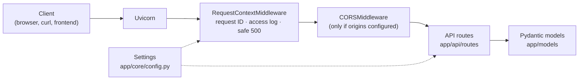

# AI Customer Support Chatbot

A backend API for an AI-powered customer support chatbot that businesses can embed into their websites. It is built with FastAPI and designed to grow in stages, from a well-tested foundation to a production-ready assistant that answers customer questions from each client's own knowledge base.

> **Current status: Stage 1 (Foundation) is complete.**
> The API skeleton, configuration, logging and automated tests are implemented.
> **No AI or chatbot features are operational yet.** The API does not accept chat messages, call a language model or answer customer questions. Those are planned for later stages (see [Roadmap](#development-roadmap)).

---

## Contents

- [Overview](#overview)
- [Implementation status](#implementation-status)
- [Planned features](#planned-features)
- [Technology stack](#technology-stack)
- [Architecture](#architecture)
- [Prerequisites](#prerequisites)
- [Setup on Windows](#setup-on-windows)
- [Configuration](#configuration)
- [Running the API](#running-the-api)
- [API reference](#api-reference)
- [Running tests](#running-tests)
- [Logging](#logging)
- [Development roadmap](#development-roadmap)
- [Troubleshooting](#troubleshooting)

---

## Overview

### Purpose

Small and medium-sized businesses often answer the same customer questions repeatedly: order status, returns, pricing, opening hours. This project aims to provide a support assistant that:

- answers common questions instantly, around the clock;
- bases its answers on the business's own documents (FAQs, policies, product information) rather than generic knowledge;
- can be added to an existing website with minimal effort;
- hands over to a human when it cannot help.

### Intended users

| User | What they get |
|------|---------------|
| **Business owners and support teams** | A chatbot on their website that reduces repetitive support work |
| **Website visitors and customers** | Fast answers to common questions without waiting for an agent |
| **Developers and freelancers** | A clean, documented, tested codebase to customise and deploy for clients |

---

## Implementation status

### Implemented (Stage 1)

| Area | Details |
|------|---------|
| FastAPI application | App factory (`create_app`), versioned routes under `/api/v1` |
| Endpoints | `GET /` (API information), `GET /api/v1/health` (health check) |
| API documentation | Swagger UI (`/docs`), ReDoc (`/redoc`), OpenAPI schema (`/openapi.json`); disabled in production |
| Configuration | Typed, validated settings via pydantic-settings and `.env`; invalid values stop startup |
| Security defaults | Secrets kept out of code and logs, `DEBUG` blocked in production, CORS closed by default, generic 500 responses |
| Logging | Standard `logging`, configurable level, one consistent format, per-request IDs, redaction of tokens and emails |
| Tests | 64 pytest tests, 100% line coverage, fully offline (network access is blocked during tests) |
| Tooling | Pinned dependencies, Ruff linting and formatting, Git-ready project files |

### Not yet implemented

- Chat endpoint and conversation handling
- Any language model (LLM) integration
- FAQ retrieval and search (the sample FAQ data and its models exist, but nothing searches them yet)
- Document ingestion and retrieval-augmented generation (RAG)
- Database and conversation history
- User interface (Streamlit or React)
- Authentication, rate limiting, Docker and deployment

Empty folders such as `app/services/`, `app/database/` and `frontend/` are placeholders for these later stages.

---

## Planned features

These are goals, not current functionality.

- **AI chat:** natural-language answers to customer questions via a `/chat` endpoint
- **Knowledge-base answers (RAG):** answers grounded in each client's documents, with fewer made-up responses
- **Conversation memory:** context kept across messages in a session
- **Human handover:** escalation when the assistant cannot answer confidently
- **Admin interface:** upload and manage knowledge-base documents
- **Embeddable widget:** a React chat widget that clients add to their site with a script tag
- **Multi-client support:** separate configuration and knowledge per business
- **Production readiness:** authentication, rate limiting, monitoring, Docker deployment

---

## Technology stack

### In use now

| Purpose | Technology |
|---------|------------|
| Language | Python 3.11+ (developed and tested on 3.13) |
| Web framework | [FastAPI](https://fastapi.tiangolo.com/) |
| ASGI server | [Uvicorn](https://www.uvicorn.org/) |
| Data validation | [Pydantic v2](https://docs.pydantic.dev/) |
| Configuration | [pydantic-settings](https://docs.pydantic.dev/latest/concepts/pydantic_settings/) + python-dotenv |
| Testing | pytest, pytest-cov, FastAPI `TestClient` (httpx) |
| Code quality | [Ruff](https://docs.astral.sh/ruff/) (lint + format) |

### Planned (not installed)

| Purpose | Candidates |
|---------|------------|
| Language model | OpenAI API or another LLM provider |
| Orchestration and RAG | LangChain / LangGraph |
| Embeddings and vector search | Sentence Transformers, a vector database (e.g. Chroma) |
| Frontend | Streamlit (prototype), then React |

---

## Architecture

### Request flow



### Layers

| Layer | Folder | Responsibility | Status |
|-------|--------|----------------|--------|
| Entry point | `app/main.py` | Builds and configures the app | Implemented |
| API | `app/api/routes/` | HTTP only: parse requests, return responses | Implemented |
| Models | `app/models/` | Request and response schemas | Implemented |
| Core | `app/core/` | Settings, logging, middleware | Implemented |
| Services | `app/services/` | Business logic (chat, retrieval), independent of HTTP | Placeholder |
| Database | `app/database/` | Persistence (conversations, documents) | Placeholder |

Routes stay thin and delegate to services, so the AI logic added in later stages can be developed and tested without touching the HTTP layer.

### Project structure

```
ai-customer-support-chatbot/
├── app/
│   ├── __init__.py            # Package version (__version__)
│   ├── main.py                # create_app() factory and ASGI app
│   ├── api/routes/
│   │   └── health.py          # GET /api/v1/health
│   ├── core/
│   │   ├── config.py          # Typed settings from environment / .env
│   │   ├── logging_config.py  # Logging setup and redaction
│   │   └── middleware.py      # Request ID, access log, safe 500 handler
│   ├── models/
│   │   ├── health.py          # HealthResponse
│   │   └── root.py            # RootResponse
│   ├── services/              # (later stages)
│   └── database/              # (later stages)
├── frontend/                  # (later stages) Streamlit, then React
├── data/
│   └── faqs.json              # Sample FAQ knowledge base (fictional store; replaceable)
├── tests/                     # pytest suite
├── .env.example               # Documented example configuration
├── requirements.txt           # Pinned, tested dependencies
├── pyproject.toml             # Project metadata, pytest and Ruff settings
└── README.md
```

---

## Prerequisites

| Requirement | Notes |
|-------------|-------|
| Windows 10 or 11 | Instructions use PowerShell. macOS/Linux work with equivalent commands |
| Python 3.11 or newer | 3.13 recommended. Check with `py --version` |
| Git | Check with `git --version` |
| VS Code (optional) | With the Python extension |

No API keys or internet services are needed to run Stage 1.

---

## Setup on Windows

Run all commands in **PowerShell** from the project root.

### 1. Get the code

```powershell
git clone https://github.com/<your-username>/ai-customer-support-chatbot.git
cd ai-customer-support-chatbot
```

### 2. Create a virtual environment

```powershell
py -3.13 -m venv .venv
```

This creates an isolated Python environment in `.venv/`, so project packages don't affect other projects. Use `py -3.11` or `py -3.12` if that is the version you have.

### 3. Activate the virtual environment

```powershell
.\.venv\Scripts\Activate.ps1
```

Your prompt should now start with `(.venv)`. Activate it in every new terminal before working on the project.

| Shell | Activation command |
|-------|--------------------|
| PowerShell | `.\.venv\Scripts\Activate.ps1` |
| Command Prompt (cmd) | `.venv\Scripts\activate.bat` |
| Git Bash | `source .venv/Scripts/activate` |

To deactivate, run `deactivate`.

**VS Code:** press `Ctrl+Shift+P`, choose **Python: Select Interpreter**, and pick `.venv\Scripts\python.exe`. New terminals will then activate it automatically.

### 4. Install dependencies

```powershell
python -m pip install --upgrade pip
pip install -r requirements.txt
```

`requirements.txt` pins exact versions that have been tested together, so every machine installs the same setup.

### 5. Configure the environment

```powershell
Copy-Item .env.example .env
```

The defaults work as-is for local development. See [Configuration](#configuration) to change them.

---

## Configuration

Settings are defined in [app/core/config.py](app/core/config.py) using pydantic-settings. Every variable is optional, and the defaults are safe for local development.

### How values are loaded

Values are resolved in this order (highest priority first):

1. **Environment variables** set in the shell or on the server, e.g. `$env:APP_ENV = "staging"`
2. **`.env` file** in the project root. It is always found, whichever directory you run commands from.
3. **Defaults** defined in `Settings`

Variable names are case-insensitive. All values are validated at startup, so an invalid value (e.g. `APP_ENV=prod`) stops the app with a clear error instead of misbehaving later.

### Variables

| Variable | Default | Rules |
|----------|---------|-------|
| `APP_NAME` | `AI Customer Support Chatbot API` | 1–100 characters |
| `APP_ENV` | `development` | `development`, `staging` or `production`. Production disables the docs endpoints |
| `DEBUG` | `false` | `true` / `false`. Must be `false` in production |
| `LOG_LEVEL` | `INFO` | `DEBUG`, `INFO`, `WARNING`, `ERROR` or `CRITICAL` |
| `API_V1_PREFIX` | `/api/v1` | Starts with `/`, no trailing slash |
| `CORS_ORIGINS` | `[]` | JSON list of full origins, e.g. `["http://localhost:8501"]`. No `*` |
| `OPENAI_API_KEY` | *(unset)* | **Not used in Stage 1.** Optional, reserved for a later stage |

The application version is defined in code (`app/__init__.py`), not in the environment.

### Secrets

- **Never commit `.env`.** It is excluded by `.gitignore`. Only `.env.example`, which has no real values, is committed.
- **Never hardcode API keys** in source code. Set them in `.env` locally or as environment variables on the server.
- Secret settings use Pydantic's `SecretStr`, which displays as `**********` in output.
- At startup the app logs a summary that states *whether* a key is set, never its value.

---

## Running the API

With the virtual environment activated:

```powershell
uvicorn app.main:app --reload
```

`--reload` restarts the server when code changes. Use it in development only. The API is then available at:

| URL | Description |
|-----|-------------|
| http://127.0.0.1:8000/ | API information |
| http://127.0.0.1:8000/api/v1/health | Health check |
| http://127.0.0.1:8000/docs | Swagger UI: interactive docs where you can try requests |
| http://127.0.0.1:8000/redoc | ReDoc: readable reference documentation |
| http://127.0.0.1:8000/openapi.json | Machine-readable OpenAPI schema |

Stop the server with `Ctrl+C`. To use another port: `uvicorn app.main:app --reload --port 8001`.

---

## API reference

All responses are JSON. Every response includes an `X-Request-ID` header whose value also appears in the server logs (`req=...`), which helps trace a specific request.

### `GET /`

Returns basic information about the API.

```powershell
Invoke-RestMethod http://127.0.0.1:8000/
```

```json
{
  "message": "AI Customer Support Chatbot API",
  "version": "0.1.0"
}
```

### `GET /api/v1/health`

Reports that the service is running. Intended for uptime monitors, load balancers and deployment checks. It does no expensive work, so it is safe to call frequently.

```powershell
Invoke-RestMethod http://127.0.0.1:8000/api/v1/health
```

```json
{
  "status": "healthy",
  "service": "ai-customer-support-chatbot"
}
```

### Documentation endpoints

| Method | Path | Returns |
|--------|------|---------|
| `GET` | `/docs` | Swagger UI (HTML) |
| `GET` | `/redoc` | ReDoc (HTML) |
| `GET` | `/openapi.json` | OpenAPI 3 schema (JSON) |

These return `404` when `APP_ENV=production`, so the full API map is not exposed publicly.

### Errors

| Status | When | Body |
|--------|------|------|
| `404` | Unknown path | `{"detail": "Not Found"}` |
| `500` | Unexpected server error | `{"detail": "Internal server error", "request_id": "<id>"}` |

Internal error details are written to the server log only, never returned to the client.

---

## Running tests

With the virtual environment activated, from the project root:

```powershell
pytest                                       # run all tests
pytest -v                                    # list each test
pytest tests/test_health.py                  # run one file
pytest --cov=app --cov-report=term-missing   # with a coverage report
```

The suite currently has **64 tests with 100% line coverage**, and runs in about a second.

| File | Covers |
|------|--------|
| `test_root.py` | `GET /` status and response |
| `test_health.py` | Health endpoint status, structure and routing |
| `test_docs.py` | OpenAPI schema, Swagger UI, ReDoc; disabled in production |
| `test_config.py` | Defaults, `.env` and environment loading, validation, secret masking |
| `test_logging.py` | Levels, format, handler count, redaction |
| `test_app.py` | Request IDs, safe 500 errors, CORS |
| `test_isolation.py` | Proves tests cannot reach the internet |

Tests are fully isolated:

- They never call external APIs. Any attempt to reach a non-local host fails the test.
- They ignore your local `.env` and shell variables, so results are the same on every machine.
- `TestClient` calls the app in-process. No server needs to be running.

### Code quality

```powershell
ruff check .      # lint
ruff format .     # auto-format
```

---

## Logging

Logging uses Python's standard `logging` module, configured in [app/core/logging_config.py](app/core/logging_config.py).

```
2026-10-10 22:28:19,652 | INFO     | app.request | req=95389afc4a29... | GET /api/v1/health -> 200 (50.7 ms)
```

- **Format:** timestamp, level, logger name, request ID and message. Uvicorn's own messages use the same format.
- **Level:** controlled by `LOG_LEVEL`.
- **No duplicates:** a single handler on the root logger. Reconfiguring never repeats output.
- **Sensitive data:** requests are logged by path only, without query strings, headers or bodies. As a safety net, bearer tokens, API keys, `password=`/`token=` values and email addresses are redacted from every line, including tracebacks.
- **In new modules:** use `logger = logging.getLogger(__name__)`.

---

## Development roadmap

The roadmap is indicative; scope and order may change as the project evolves.

| Stage | Focus | Status |
|-------|-------|--------|
| **1. Foundation** | FastAPI structure, configuration, logging, tests, Git setup | **Complete** |
| **2. AI chat** | `/chat` endpoint, LLM integration, prompt design, error handling for model calls | Planned |
| **3. Knowledge base (RAG)** | Document ingestion from `data/`, embeddings, vector search, grounded answers | Planned |
| **4. Conversations and storage** | Database, session history, conversation memory | Planned |
| **5. Streamlit frontend** | Chat UI and simple admin page for testing and demos | Planned |
| **6. React widget** | Embeddable chat widget for client websites | Planned |
| **7. Production readiness** | Authentication, rate limiting, Docker, deployment, monitoring | Planned |

---

## Troubleshooting

| Problem | Solution |
|---------|----------|
| `Activate.ps1 cannot be loaded because running scripts is disabled` | Run once: `Set-ExecutionPolicy -Scope CurrentUser RemoteSigned` |
| `py` is not recognised | Install Python from [python.org](https://www.python.org/downloads/) with the **py launcher** option, or use `python` instead |
| `ModuleNotFoundError: No module named 'fastapi'` | The virtual environment is not active. Activate it and reinstall with `pip install -r requirements.txt` |
| `ModuleNotFoundError: No module named 'app'` | Run commands from the project root, not from inside `app/` or `tests/` |
| App stops with a `ValidationError` on startup | A value in `.env` or the environment is invalid. The message names the variable; compare with `.env.example` |
| Port 8000 is already in use | Start on another port: `uvicorn app.main:app --reload --port 8001` |
| `/docs` returns 404 | `APP_ENV` is set to `production`. Use `development` locally |
