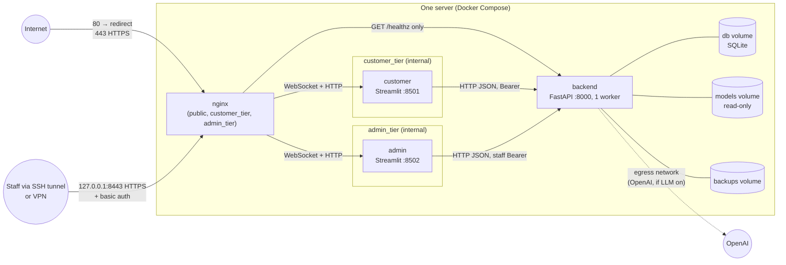

# Deployment architecture: single server, Docker Compose (Stage 13)

The design for running the chatbot on one Linux server with Docker Compose: Nginx in
front of the FastAPI backend, the customer Streamlit page and the staff Streamlit
dashboard. The files are in [deploy/](../deploy/):

| File | Purpose |
|---|---|
| [deploy/compose.yaml](../deploy/compose.yaml) | Production: services, networks, volumes, health-gated start order, restart policies, hardening, resource limits |
| [deploy/compose.dev.yaml](../deploy/compose.dev.yaml) | Optional development override, layered on top ([section 6](#development-override)) |
| [deploy/Dockerfile](../deploy/Dockerfile) | Three images, `backend`, `customer` and `admin`, from one shared base stage ([section 13](#13-images)) |
| `deploy/requirements/backend.txt`, `frontend.txt` | Hash-locked dependency sets for the images, generated by [scripts/lock_deploy_requirements.py](../scripts/lock_deploy_requirements.py) |
| [deploy/nginx/nginx.conf.template](../deploy/nginx/nginx.conf.template) | TLS, hostname checks, routing (pages, customer API allow-list), limits, timeouts, staff access; rendered with `PUBLIC_HOSTNAME`, `ADMIN_HOSTNAME` at startup ([section 14](#14-reverse-proxy)) |
| [deploy/nginx/snippets/](../deploy/nginx/snippets/) | Shared Nginx pieces: forwarded headers, WebSocket proxying, security headers, safe error responses, ACME challenges, secure cookies |
| [docs/backup-and-restore.md](backup-and-restore.md) | Backup and restore commands (`scripts/backup_database.py`, `scripts/restore_database.py`), retention, encryption options, permissions, the restore procedure |
| [docs/monitoring.md](monitoring.md) | Operational metrics kept in the backend's memory (process-local, reset on restart): requests, errors, latencies per stage, ticket and index failures, uptime; staff-only, with a periodic copy in the log |
| [docs/logging.md](logging.md) | Structured logs: JSON lines on standard output (Docker's rotated `json-file` driver), fixed fields, request and correlation IDs across the pages and the backend, levels, what is never logged, `jq` queries |
| [docs/deployment-runbook.md](deployment-runbook.md) | **The operator's runbook**: server requirements, Docker, firewall and DNS; deployment and verification; logs, restarts, updates, migrations, backups, restores, secret rotation, certificates; incident response and rollback |
| [docs/deployment-rollback.md](deployment-rollback.md) | Rollback strategy: the release recorded in the images and the database, automatic backups before schema upgrades, older releases refusing a newer schema instead of discarding it, and the tested recovery |
| [docs/deployment-tests.md](deployment-tests.md) | Opt-in tests that build and run the Docker stack and check it from outside (`RUN_DEPLOYMENT_TESTS=1`); skipped, never passed, without Docker |
| [docs/shutdown-and-restart.md](shutdown-and-restart.md) | Graceful stop, crashes and restarts verified on Docker: requests in flight, data surviving restarts, the restart policy, health recovery, and how clients retry after an uncertain outcome |
| [docs/concurrency-and-limits.md](concurrency-and-limits.md) | Bounded concurrency tests (synthetic data, mocked LLM): isolation, idempotency and database consistency under load, latency, memory, the busy-conversation fix, and safe operating assumptions for one server |
| [docs/retrieval-and-database.md](retrieval-and-database.md) | Retrieval and database operations measured on 20,000 conversations and tickets: the indexes and query changes made, and what was reviewed and kept |
| [docs/embedding-model.md](embedding-model.md) | The embedding model: pinned version, measured memory, how it is fetched, verified against corruption, loaded once and cached, and what is not verified (several workers) |
| [docs/performance-profile.md](performance-profile.md) | Measured startup, first and warm chat latency, retrieval and database latency, memory, CPU and image sizes, locally and in the production containers (`scripts/profile_performance.py`) |
| [docs/error-reporting.md](error-reporting.md) | What each production failure returns (request ID, `retryable`, no internals) and where the operator sees it: logs, readiness, monitoring |
| [docs/health-checks.md](health-checks.md) | Liveness (`/health`), readiness (`/ready`) and public status (`/status`, behind `/healthz`): what each checks, which dependencies are optional, what is public, and the Compose health checks |
| [docs/sqlite-review.md](sqlite-review.md) | SQLite under the real workload: settings, transactions around the LLM call, concurrent writes, network-filesystem guard, migrations, backups (`scripts/backup_database.py`), when PostgreSQL becomes appropriate |
| [docs/authentication-review.md](authentication-review.md) | Customer and staff authentication as deployed: tokens, expiry, revocation, authorization coverage, CSRF, Streamlit sessions, transport; the authentication deployment blockers |
| [docs/https-setup.md](https-setup.md) | HTTPS with Let's Encrypt: DNS, issuance, renewal (`deploy/certbot/deploy-hook.sh`), redirects, cookies, expiry monitoring (`scripts/check_certificate.py`) |
| [deploy/.env.example](../deploy/.env.example) | Compose variables: environment, public and dashboard hostnames, proxy ports, model revision |
| `deploy/environments/<env>/*.env.example` | Application settings per environment (`production`, `staging`) |
| [.dockerignore](../.dockerignore) | Allow-list of what enters the build |
| [tests/test_deployment_config.py](../tests/test_deployment_config.py) | Checks of the properties below (59 tests, plus 4 in `tests/test_trusted_proxy.py`) |

> **Status: built and run on 2026-10-19** with Docker Engine 28.1.1 and Compose
> v2.35.1 (WSL 2, Ubuntu, on the development machine). All three images built, the
> stack started healthy, and services communicated as designed
> ([section 11](#11-verification)). That run was local, with a self-signed certificate,
> no real traffic and no external network scan. Running containers do not by
> themselves make the application production-ready:
> [docs/deployment-readiness.md](deployment-readiness.md) still has blockers this design
> does not address (staff identity, monitoring, scheduled backups).

## Contents

1. [Overview](#1-overview)
2. [Networks](#2-networks)
3. [Traffic flows](#3-traffic-flows)
4. [Staff access restriction](#4-staff-access-restriction)
5. [Persistent storage](#5-persistent-storage)
6. [Environment-specific configuration](#6-environment-specific-configuration)
7. [Container hardening](#7-container-hardening)
8. [Rate limiting behind the proxy](#8-rate-limiting-behind-the-proxy)
9. [Redis and PostgreSQL: assessment](#9-redis-and-postgresql-assessment)
10. [First deployment](#10-first-deployment)
11. [Verification](#11-verification)
12. [What this does and does not change in the readiness assessment](#12-what-this-does-and-does-not-change-in-the-readiness-assessment)
13. [Images](#13-images)
14. [Reverse proxy](#14-reverse-proxy)

---

## 1. Overview



| Service | Image | Listens on | Published | Notes |
|---|---|---|---|---|
| `nginx` | `nginxinc/nginx-unprivileged:1.30.6-alpine`, pinned by digest | 8080, 8443, 9443 | 80, 443 on all interfaces; 8443 on 127.0.0.1 | Only service with published ports |
| `backend` | `support-chatbot-backend` (`deploy/Dockerfile`, target `backend`) | 8000 | No | One uvicorn worker, `--no-server-header` |
| `customer` | `support-chatbot-customer` (target `customer`) | 8501 | No | `frontend/app.py` |
| `admin` | `support-chatbot-admin` (target `admin`) | 8502 | No | `frontend/admin_app.py` |
| `model-init` | backend image | none | No | One-off (profile `setup`): fetches the pinned model |
| `backup` | backend image | none | No | Daily verified database backup into the `backups` volume; no network ([docs/backup-and-restore.md](backup-and-restore.md)) |
| `backup-offsite` | `restic/restic:0.19.1`, pinned by digest | none | No | Opt-in (profile `offsite`): encrypted daily copies of the backups to off-server storage; outbound only |

Service names are fixed in the Compose file (`name: support-chatbot`), so containers,
networks and volumes are always `support-chatbot-<name>`, and services find each other
by name (`http://backend:8000`).

No Kubernetes, Redis or PostgreSQL is introduced ([section 9](#9-redis-and-postgresql-assessment)).

## 2. Networks

| Network | Internal | Members | Purpose |
|---|---|---|---|
| `public` | No | `nginx` | Carries the published ports |
| `customer_tier` | **Yes** | `nginx` (fixed `172.30.1.10`), `customer`, `backend` (also as `backend-api`) | Customer page and customer API traffic. Subnet `172.30.1.0/24` |
| `admin_tier` | **Yes** | `nginx` (fixed `172.30.2.10`), `admin`, `backend` | Staff dashboard traffic. Subnet `172.30.2.0/24` |
| `egress` | No | `backend`, `model-init` | Outbound only: OpenAI (when `LLM_ENABLED=true`) and the one-off model download. Nothing is published on it |

- **The backend is never published** and is not on `public`. From outside the server
  it can only be reached through what Nginx proxies: `/healthz` and an allow-list of
  customer API routes ([section 14](#14-reverse-proxy)).
- **Fixed subnets and Nginx addresses** exist for one reason: the backend trusts
  forwarded client addresses from exactly one address, Nginx's on the customer network.
  If a subnet clashes with a network already on the host, change the subnet, Nginx's
  `ipv4_address` and the backend's `FORWARDED_ALLOW_IPS` together.
- **Streamlit ports are never published.** 8501 and 8502 exist only on the internal
  networks.
- **The two pages share no network.** A compromised customer container cannot open
  the staff dashboard's port, and the reverse holds too.
- Internal networks have **no route to the internet**, so neither Streamlit container
  can make outbound connections.
- The backend keeps `egress` even with the LLM off. To remove its internet access
  entirely in that case, drop `egress` from the backend in a Compose override file.

## 3. Traffic flows

| Flow | Path |
|---|---|
| Customer chat | Browser → `nginx:8443` (TLS) → `customer:8501` (HTTP and the `/_stcore/stream` WebSocket) → `backend:8000` (server-side HTTP with the conversation token) |
| Customer API (other clients) | Client → `nginx:8443/api/v1/…` (TLS, allow-list) → `backend-api:8000` over `customer_tier`, from Nginx's trusted address |
| Staff dashboard | Browser → SSH tunnel or VPN → `nginx:9443` (TLS + basic auth) → `admin:8502` → `backend:8000` (staff token) |
| Uptime monitoring | Monitor → `nginx:8443/healthz` → `backend:8000/api/v1/status` (200 when the knowledge base and storage are usable, 503 otherwise; the verdict only, no checks: [docs/health-checks.md](health-checks.md)) |
| HTTP | `nginx:8080` answers with a `308` redirect to `https://PUBLIC_HOSTNAME` (the configured name, never the client's `Host` header) |
| Anything else | Requests by IP address or for another hostname are refused: the TLS handshake is rejected, or the connection is closed without a response (`444`). A request whose `Host` differs from the TLS name gets `421` |
| Outbound | `backend` → OpenAI over `egress`, only when the LLM is enabled |

**Which API routes are reachable:** the Streamlit pages call the API server-side and
need no public route. Other clients, such as a website widget or a mobile app
([docs/chat-api.md](chat-api.md)), get the customer routes through an Nginx allow-list:
conversations, chat, the customer's own tickets, the read-only FAQs, health and
readiness. Staff routes, the admin API, the token-free compute endpoints and the API docs
are not routed ([section 14](#14-reverse-proxy)). A browser client on another origin
also needs `CORS_ORIGINS`; a client on the same origin does not.

Traffic between Streamlit and the backend is plain HTTP on a Docker bridge that never
leaves the server. The frontend logs its standard warning for `http://` to a
non-loopback host (`frontend/config.py`); here that warning is expected.

## 4. Staff access restriction

Three independent layers, each of which must be passed:

1. **Network:** the dashboard listener is published on `127.0.0.1:8443` by default
   (`ADMIN_BIND`). Staff reach it through an SSH tunnel
   (`ssh -L 8443:127.0.0.1:8443 user@server`, then `https://localhost:8443`) or a VPN
   address set in `ADMIN_BIND`. The listener answers only `ADMIN_HOSTNAME` (default
   `localhost`, the tunnel's name); by IP address or under any other name the TLS
   handshake is refused. The listener also accepts **private source addresses only**
   (loopback, RFC 1918, `100.64.0.0/10`, IPv6 ULA:
   `snippets/admin-network-allowlist.conf`), so widening `ADMIN_BIND` for a VPN
   cannot make the dashboard public while staff authentication is a prototype
   ([docs/authentication-review.md](authentication-review.md)).
2. **HTTP basic authentication** at Nginx (`deploy/nginx/admin.htpasswd`). This is a
   credential separate from the staff token. It also stops anonymous visitors from
   reaching the Streamlit app at all.
3. **The staff bearer token** checked by the backend, with roles
   ([docs/admin-dashboard.md](admin-dashboard.md)).

The staff API (`/api/v1/admin/*`, ticket status changes) is unreachable from outside:
only the admin container calls it, over `admin_tier`. API documentation (`/docs`) is
off in production (`APP_ENV=production`) and not proxied in any environment.

This restricts **where** staff can connect from. It does not fix the staff identity
model (static tokens, no MFA, revocation needs a restart: SEC-08). A tunnel or VPN plus
basic auth makes a leaked token much harder to use, but the token is still the final
credential.

## 5. Persistent storage

| Volume | Mounted at | Holds | Notes |
|---|---|---|---|
| `db` | `backend:/var/lib/chatbot` | `conversations.db` and its WAL files: conversations, tickets, contacts, **FAQs** (since Stage 11), audit log | `DATABASE_URL=sqlite:////var/lib/chatbot/conversations.db`, fixed in `compose.yaml` |
| `backups` | `backend:/app/data/backups` | Copies made by `scripts.import_faqs --backup` | Copy off the server; holds customer data unencrypted |
| `models` | `backend:/models` **read-only**; `model-init:/models` read-write | The embedding model folder `all-MiniLM-L6-v2` | Written once by `model-init` |

**Required application data.** The FAQ knowledge base lives in the database, so it is
covered by `db`. The FAQ seed file `data/faqs.json` is built into the backend image
(`FAQ_DATA_PATH=/app/data/faqs.json`). It is read only to fill an empty FAQ table on the
first start, and it is versioned with the code. No other runtime data exists:
evaluation files are excluded from the images.

**Model cache.** The backend loads the model from a plain folder
(`EMBEDDING_MODEL_NAME=/models/all-MiniLM-L6-v2`) with `HF_HUB_OFFLINE=1`, so it never
contacts Hugging Face. `model-init` downloads revision
`1110a243fdf4706b3f48f1d95db1a4f5529b4d41`, the revision in the local cache that every
Stage 12 evaluation used. This closes the "model revision not pinned" limitation in
the readiness assessment. Loading that revision from a plain folder gives vectors
identical to loading it by name (maximum difference 0.0, checked on 2026-10-19). If
the model is missing, the backend still serves keyword-only answers, and
`/api/v1/ready` reports `semantic_search: unavailable`.

**Not persisted, by design:** Streamlit session state (in memory). Restarting the
`customer` container ends open chats in the page. The conversations stay in the
database, but the page loses their tokens, so customers start a new conversation.
Rate-limit counters and the LLM circuit breaker also reset on a backend restart.

Volume directories are created in the image and owned by the app user (uid 10001), so
new named volumes are writable by the non-root process without any `chown` at runtime.

## 6. Environment-specific configuration

Two levels, both kept out of git:

| File | Read by | Contents |
|---|---|---|
| `deploy/.env` (from `.env.example`) | Docker Compose | `DEPLOY_ENV`; the public hostname (`PUBLIC_HOSTNAME`); the dashboard hostname and listener (`ADMIN_HOSTNAME`, `ADMIN_BIND`, `ADMIN_HTTPS_PORT`); the proxy's interface and ports; image tag; model revision |
| `deploy/environments/<DEPLOY_ENV>/backend.env` | `backend` | Application settings: `APP_ENV`, rate limits, staff hashes, LLM switch and key |
| `deploy/environments/<DEPLOY_ENV>/customer.env` | `customer` | Page settings: demo notice, example questions, timeouts |
| `deploy/environments/<DEPLOY_ENV>/admin.env` | `admin` | Dashboard session limits, timeouts |

- `DEPLOY_ENV` selects the folder: `production` and `staging` are provided. Staging
  uses `APP_ENV=staging`, the demo notice and lower site-wide limits. Compose refuses
  to start if `DEPLOY_ENV` is unset.
- **Paths and wiring are fixed in `compose.yaml`**, not in the environment files:
  `DATABASE_URL`, `FAQ_DATA_PATH`, `EMBEDDING_MODEL_NAME`, `HF_HUB_OFFLINE` and
  `BACKEND_API_URL`. An environment file cannot point the backend at another database
  or the pages at another backend.
- Running Compose from `deploy/` means it reads `deploy/.env`, never the project
  root's development `.env`. The root `.env` is also excluded from the build context,
  so it can never end up inside an image, where `Settings` would load it.
- Every example validates against the application's settings classes
  (`test_backend_environment_files_are_valid_settings`,
  `test_page_environment_files_are_valid_settings`). The application itself still
  refuses invalid values at startup (verified in
  [docs/deployment-readiness.md §4](deployment-readiness.md#4-verification-performed-for-this-assessment)).
- Secrets (`OPENAI_API_KEY`, `STAFF_TOKEN_HASHES`) live in `backend.env`, readable only
  by the deploying user (`chmod 600`). No secrets manager is used. Compose `secrets:`
  would need code changes, because the settings read environment variables only.
- **`docker compose config` prints the values from the environment files, secrets
  included** (observed: the test key appeared in its output). That is how Compose
  works. Never paste its output into tickets or chats; use `docker compose config
  --quiet` to check syntax only. The application itself never prints them: the
  backend's startup log shows only `openai_api_key_set: True` (verified).
- Every variable of the application, with its range and effect, is documented in the
  root [.env.example](../.env.example), grouped as Application, Security, AI,
  Conversations, Support, Streamlit pages and Deployment. Every Compose variable is in
  [deploy/.env.example](../deploy/.env.example). Tests check both directions: no
  setting undocumented, no documented variable unused
  (`test_env_example_documents_every_setting_and_nothing_else`,
  `test_every_compose_variable_is_documented_and_every_documented_one_is_used`).

### Required configuration and how it fails

Checked on Docker on 2026-10-19 (section 11). Each failure stops the process with a
message that names the variable or file and how to fix it, never a value:

| Missing or unsafe | Who stops | Message (shortened) |
|---|---|---|
| `PUBLIC_HOSTNAME` unset | Compose, before anything starts | `required variable PUBLIC_HOSTNAME is missing a value: set PUBLIC_HOSTNAME in deploy/.env (the customer site name)` |
| `DEPLOY_ENV` unset | Compose | `set DEPLOY_ENV in deploy/.env` |
| An environment file missing | Compose | `env file …/environments/production/customer.env not found` |
| Certificate folder or `admin.htpasswd` missing | Docker, at `up` | `bind source path does not exist: …/nginx/admin.htpasswd`. The mounts use `create_host_path: false`; with the short syntax Docker would silently create an empty directory, and the dashboard would fail only at its first request |
| `DEBUG=true` in production | Backend | `DEBUG must be false when APP_ENV=production.` |
| In-memory `DATABASE_URL` in production | Backend | `DATABASE_URL must point to a database file when APP_ENV=production …` |
| `RATE_LIMIT_ENABLED=false` in production | Backend | `RATE_LIMIT_ENABLED must be true when APP_ENV=production …` |
| `LLM_ENABLED=true` without a usable key | Backend | `OPENAI_API_KEY looks incomplete …` (or *requires OPENAI_API_KEY*); the key was printed **0 times** |
| A malformed staff entry | Backend | `STAFF_TOKEN_HASHES: entry 1 must be 'staff_id:role:<64 lowercase hex characters>' …`; the entry was printed **0 times** |
| `http://` CORS origin in production | Backend | `CORS_ORIGINS must use https:// when APP_ENV=production` |

The backend reports the first failed production rule; fix it and start again to see
the next. When the process has no `.env` file, as in the containers, messages now say
that the values come from the environment, instead of pointing at a file that does not
exist. Not a failure, but logged as a **warning** in production: no staff configured,
which leaves the dashboard with nobody able to sign in.

Development stays permissive on purpose: `APP_ENV=development` and `staging` accept an
in-memory database and switched-off rate limits, for tests, evaluations and load tests
(verified: staging with both started without complaint). The evaluation and
measurement scripts set `app_env="development"` explicitly, so a production value in a
developer's shell cannot break them.

### Development override

Production and development are separate files. `compose.yaml` is the production
configuration and never refers to the override. `compose.dev.yaml` is added only on
request:

```bash
docker compose -f compose.yaml -f compose.dev.yaml up -d --build
```

| | Production (`compose.yaml`) | Development (`+ compose.dev.yaml`) |
|---|---|---|
| Published | Nginx only: 80, 443, dashboard on 127.0.0.1 | Backend `127.0.0.1:8000`, customer `127.0.0.1:8501`, admin `127.0.0.1:8502`. Nginx only with `--profile proxy` |
| Code | Baked into the images | `app/` and `frontend/` bind-mounted read-only; uvicorn `--reload` and Streamlit run-on-save, with polling |
| `APP_ENV` | From the environment file (`production`) | `development` (API docs at `/docs`), `LOG_LEVEL=DEBUG` |
| Hardening, limits, health checks, volumes | As in section 7 | Inherited unchanged (`test_development_override_never_weakens_hardening`) |

Ports can be published only from a non-internal network, so the override attaches the
three services to an extra `dev_host` network. The production tiers stay internal.

## 7. Container hardening

Applied to every service through the `x-hardening` block in `compose.yaml`, and
enforced by `test_every_service_is_hardened`:

| Control | Setting |
|---|---|
| No privileged containers | No `privileged`; no host network, PID or IPC namespace |
| No Docker socket | No container mounts `/var/run/docker.sock` or any host system path (`test_no_container_mounts_the_docker_socket_or_host_system_paths`) |
| No Linux capabilities | `cap_drop: [ALL]`, no `cap_add`. Nginx uses the unprivileged image and ports above 1024, so it needs no `NET_BIND_SERVICE` |
| No privilege escalation | `no-new-privileges:true` |
| Non-root | App images run as uid 10001; Nginx as uid 101 |
| Read-only root filesystem | `read_only: true`; writable paths are the named volumes and a size-limited tmpfs at `/tmp` |
| Resource limits | Memory: backend 2 GB, pages 512 MB, Nginx 128 MB. CPU: 2, 1, 1 and 0.5 cores. `pids_limit: 256`. Applied and enforced, as measured in section 11 (the backend's cgroup reports a 2 GB limit; usage after warm-up 533 MB) |
| Log size | `json-file` driver, 10 MB × 5 files per container |
| Minimal images | Frontend image has no AI packages; backend excludes Streamlit and development tools; build context is an allow-list |

Base images are pinned by exact version **and** digest: Python 3.13.16 on Debian 13
(`python:3.13.16-slim-trixie@sha256:…`) and Nginx 1.30.6
(`nginxinc/nginx-unprivileged:1.30.6-alpine@sha256:…`). No image uses `latest`
([section 13](#13-images)).

## 8. Rate limiting behind the proxy

**Finding (from reading the code, not observed in a running deployment):** the backend
keys its per-IP limits on the TCP peer address (`app/api/dependencies.py`), and the
frontend does not forward the visitor's address. Behind Streamlit, every customer
reaches the backend from the `customer` container's address. Under the default limits,
**20 new conversations per minute and 120 requests per minute would apply to all
customers together**. This is already true in the development setup; it matters once
there is real traffic.

The design handles it without code changes:

- **Per visitor at Nginx** (the real client address): 10 requests per second (burst
  40), **20 new Streamlit sessions per minute** (each starts one conversation), and at
  most 20 open connections per address.
- **Site-wide ceilings in the backend:** `backend.env.example` raises the per-IP
  limits to 3,000 requests and 300 new conversations per minute in production (600 and
  60 in staging). Behind the page these act as a whole-site safety valve. Size them to
  expected traffic.
- **Unchanged and still per customer:** chat messages (20 per minute) and support
  requests (5 per minute) are keyed by conversation and token, not by address.

What Nginx cannot limit: messages inside an open WebSocket. That is what the
per-conversation chat limit in the backend covers. A future code change could have the
pages forward the visitor's address, with the backend trusting it only from the page
containers. That would make the backend's own per-IP limits per visitor again. It is
recommended, not done here.

## 9. Redis and PostgreSQL: assessment

The task allows Redis or PostgreSQL only for a verified blocker in the existing
implementation. The verified findings were checked against this architecture:

| Finding | Verified where | Blocks this architecture? | Decision |
|---|---|---|---|
| SEC-09: rate limits are per process | Security audit | **No.** It blocks *several* backend processes. This design runs exactly one (`--workers 1`, one service, no replicas; `test_backend_runs_exactly_one_worker`) | No Redis |
| SEC-10: FAQ catalogue and semantic index are per process; other workers serve stale FAQs after an edit | Security audit | **No**, for the same reason | No Redis |
| SQLite allows one writer; chat p99 7.1 s at 8 parallel conversations, 0 errors | Load test (test report) | **No.** It is a capacity limit, not a failure at measured load. Writers wait up to 5 s, then get `503` with `Retry-After` | No PostgreSQL now |
| SQLite cannot be shared by several servers | Security audit §7 | **No.** This is a single-server design | No PostgreSQL |
| Per-IP limits see the page container ([section 8](#8-rate-limiting-behind-the-proxy)) | Code reading (this design) | **No.** Handled at Nginx | No Redis |

**Conclusion: no verified blocker requires Redis or PostgreSQL for a single-server,
single-worker deployment.** None is introduced.

**Recommendation for later**, before any change of architecture: move to PostgreSQL,
and shared rate limits and catalogue revision (Redis or the database), when **any** of
these becomes true:

- more than one backend process or server is needed;
- `503` responses caused by the SQLite busy timeout appear in the logs under real
  traffic;
- chat p99 under real traffic exceeds an agreed target.

That move needs versioned migrations (the readiness assessment, "Database
migrations") and a load test of its own.

**Operating constraint that follows:** never scale the backend
(`docker compose up --scale backend=2`) or add `--workers`. Compose cannot forbid this;
the test and this document are the guard.

## 10. First deployment

On a Linux server with Docker Engine and the Compose plugin, from a checkout of the
repository:

```bash
cd deploy
cp .env.example .env                                   # set DEPLOY_ENV and PUBLIC_HOSTNAME
for f in backend customer admin; do
  cp environments/production/$f.env.example environments/production/$f.env
done
chmod 600 environments/production/*.env                # then edit backend.env

# TLS: start with a short-lived DEVELOPMENT-ONLY placeholder for the real names, then
# replace it with a trusted Let's Encrypt certificate: docs/https-setup.md, section 4
sh dev/make-dev-certificate.sh support.example.com admin.support.example.com

# Staff basic-auth file (SHA-512 crypt; you are prompted for the password)
printf 'staff:%s\n' "$(openssl passwd -6)" > nginx/admin.htpasswd

# Nginx runs as uid/gid 101 and must be able to read the key and the password file
sudo chown root:101 nginx/certs/privkey.pem nginx/admin.htpasswd
sudo chmod 640 nginx/certs/privkey.pem nginx/admin.htpasswd

docker compose build
docker compose --profile setup run --rm model-init     # fetch the pinned model once

# Staff tokens: the printed entry goes into STAFF_TOKEN_HASHES in backend.env
docker compose run --rm --no-deps backend \
  python -m scripts.create_staff_token alice --role admin

docker compose up -d
docker compose ps                                      # all services "healthy"
curl -fsS https://$PUBLIC_HOSTNAME/healthz                # by name: requests by IP are refused
```

Routine operations run inside the backend container, against the same database:

```bash
docker compose exec backend python -m scripts.cleanup_conversations
docker compose exec backend python -m scripts.anonymize_support_data --retention
```

These are not scheduled. Backups are: the `backup` service makes a verified backup daily,
and `scripts.backup_database` makes one on demand; off-server copies are an opt-in
service ([docs/backup-and-restore.md](backup-and-restore.md)).

The full operating procedure (server preparation, deployment, maintenance, incident
response, rollback) is the runbook: [docs/deployment-runbook.md](deployment-runbook.md).

## 11. Verification

### Run on Docker (2026-10-19)

**Environment:** Docker Engine 28.1.1, Compose v2.35.1, BuildKit (buildx 0.23.0),
cgroup v1, inside WSL 2 (Ubuntu) on the development machine: 4 CPUs, 3.8 GB RAM. The
project was exported from git (tracked and new files only, so no `.env`, database or
virtual environment) into a separate folder. Test-only local files were created there:
the production environment examples copied as `*.env`, a self-signed certificate and a
basic-auth file. `DEPLOY_ENV=production`, so `APP_ENV=production`. Host ports 18080,
18443 and 18444 (dashboard, loopback) were used to avoid clashes. The scripts of this run
were not kept; every result below was observed. The same procedure is now repeatable as
opt-in tests: [docs/deployment-tests.md](deployment-tests.md) (`tests/deployment/`).

| Check | Result |
|---|---|
| Configuration | `docker compose config` valid for production, and for production plus the development override |
| Build | All three images built in 689 s on a cold cache ([section 13](#13-images)) |
| Model | `model-init` fetched the pinned revision (30 files, the whole repository) into the `models` volume in 339 s. Since Stage 13 Task 18 it fetches only the 12 needed files (91.6 MB, 35 s) |
| Startup and health | From `up -d` to all four services healthy: **51 s**. Start order followed the health gates: the backend started first; customer and admin 14 s later, once the backend was healthy; Nginx 16 s after that, once both pages were healthy |
| Readiness | `/api/v1/ready`: knowledge base and storage `ok`, `llm: disabled`. `semantic_search` went from `not_loaded` to `ready` after the background preload. The backend read the model from the read-only volume and downloaded nothing |
| Read-only root filesystem | Every container ran with it. Writing to `/app` fails (`Read-only file system`); processes run as uid 10001 (pages, backend) and 101 (Nginx) |
| Customer page → backend by hostname | Inside the customer container, `BACKEND_API_URL=http://backend:8000`, and `backend` resolved on the customer network. A conversation was created and "How can I track my order?" was answered (`answered`, source `faq_001`) |
| Network isolation | From the customer container, `admin` does not resolve and the internet is unreachable. From the admin container, `customer` does not resolve; the backend is reachable |
| Through Nginx | HTTP `308` to HTTPS. `/healthz` `200` with the readiness body. Customer page `200`. **Customer WebSocket upgrade `101`**: Streamlit's XSRF and origin checks pass through the proxy. Dashboard without password `401`, with password `200`, its WebSocket `101`. `POST /api/v1/conversations` through Nginx does not reach the API (Streamlit answers `405`) |
| Security headers | HSTS, `X-Content-Type-Options`, `X-Frame-Options`, `Referrer-Policy` and the `frame-ancestors` CSP on every response; `server: nginx` without a version. The first run showed `/healthz` duplicating the backend's own security headers. Fixed (`proxy_hide_header`) and re-checked: one of each |
| Ports | `localhost:8000`, `8501` and `8502` refused; the backend and pages publish nothing; the dashboard listener is bound to `127.0.0.1` only |
| Resource limits | Applied as configured (memory, `NanoCpus`, `PidsLimit`); the backend's cgroup reports a 2 GB limit. Usage after warm-up: backend 533 MB, customer 63 MB, admin 59 MB, Nginx 8 MB |
| Restart policy | Ending the backend's main process: restart count 0 → 1, healthy again in 4 s. When WSL shut its VM down between two runs, the daemon brought all four containers back on its own (`unless-stopped`) |
| Graceful shutdown | `docker compose stop backend`: 1.9 s. uvicorn logged *Shutting down → Waiting for application shutdown → Application shutdown complete → Finished server process*. Exit code 143: uvicorn re-raises the `SIGTERM` after its clean shutdown, so this is not a failure |
| `depends_on` is not readiness | With the backend stopped, the customer page still loaded (`200`) and `/healthz` returned `502`. The pages tolerate a missing backend (their client retries, then shows an error). The health checks, not `depends_on`, report readiness. After `start`, all services were healthy within 7 s |
| Address changes | The backend was forced onto a new address (172.20.0.2 → 172.20.0.5). The customer container resolved the new address at once. Through Nginx, `/healthz` was `200` from the moment the new container was healthy, for 40 s of polling, so `server … resolve` works. Right after an earlier move, `/healthz` was briefly `502`, within the 10 s resolver cache (`valid=10s`). Moving the customer container was attempted, but it kept its address, so that case was not exercised separately |
| Persistence | A conversation created before `docker compose down` / `up -d` was read back afterwards (user and assistant messages). The `db`, `backups` and `models` volumes were kept |
| Development override | All three services healthy. `127.0.0.1:8000/docs` `200` (`APP_ENV=development`), `8501` and `8502` `200`. The backend port is not reachable on the VM's network address (loopback only). Touching `app/main.py` in the mounted source triggered *WatchFiles detected changes … Reloading*, and the backend was healthy again |
| Logs | No tracebacks, and no `CRITICAL`, `ERROR` or Nginx `[error]`/`[emerg]` lines across the run |
| Required configuration (Task 7) | Every failure in [Required configuration and how it fails](#required-configuration-and-how-it-fails) reproduced with the message shown there; secrets printed 0 times |
| Hostnames (Task 7), `PUBLIC_HOSTNAME=localhost` | `https://localhost` `200`; by IP (no SNI) or another name: TLS handshake refused; right name with a forged `Host`: `421`. HTTP: `308` to `https://localhost:18443/x?y=1`, other names and the bare IP closed (444). Dashboard: `200` as `localhost` with the password, refused by IP and under the customer site's name. The rendered config had both names substituted, Nginx's own `$host`, `$remote_addr`, `$request_uri` intact (12 uses), and no `${` left |

### Static checks

| Check | Result |
|---|---|
| `tests/test_deployment_config.py` | **39 passed**: hardening on every service, no Docker socket or host paths, only Nginx publishes ports, dashboard on loopback by default, internal networks and tier separation, one backend worker, named volumes and read-only model, pinned revision, environment examples valid against the settings classes, no secrets in examples, build context, git-ignore rules, no backend route in Nginx except readiness, WebSocket header inheritance, image stages, pinned base images, hash-locked installs, CPU-only PyTorch, no development tools, non-root user, health checks, offline model. The development override publishes only on loopback, never weakens hardening, and stays separate from production |
| Tests detect regressions | Each deliberate breakage tried failed exactly one test; files restored afterwards |

### Not verified

1. **From another machine:** the run was local. An external port scan of a real server
   (only 80 and 443 open; the dashboard port only on loopback) is still needed.
2. **A trusted certificate and the browser experience:** a self-signed certificate
   and `curl` were used, not a browser session through the proxy, and not the 1-hour
   WebSocket timeout with Streamlit's keep-alive.
3. **Per-visitor Nginx limits under load** (`429` at the configured rates), and
   whether the site-wide backend ceilings suit real traffic.
4. **The production host's kernel and cgroup version:** limits were checked on
   cgroup v1 under WSL 2; a server with cgroup v2 reports them differently.
5. **LLM enabled:** the run used `LLM_ENABLED=false`, so egress to OpenAI was not
   exercised.

## 12. What this does and does not change in the readiness assessment

| Readiness category | Effect of this design |
|---|---|
| Security | **Addresses** TLS termination, HSTS, proxy timeouts and request limits, frame protection for the Streamlit pages, the `server` header, and keeping `/docs` and `/admin` off the internet. **Still open:** a Streamlit-specific CSP, SEC-08, and a scan of the deployed instance from outside |
| Authentication | **Reduces exposure** (tunnel or VPN plus basic auth before the staff token). Does **not** fix SEC-08 |
| AI model initialization | **Addresses** the unpinned revision and runtime downloads (pinned folder, offline) |
| Resource consumption | **Adds** per-visitor limits, connection limits and proxy timeouts at Nginx, and container memory, CPU and PID limits |
| Operational documentation | **Adds** a deployment procedure for this target (section 10). A runbook is still missing |
| Monitoring | **Adds** a public readiness URL for an uptime monitor. Metrics and alerting are still missing |
| Backup and recovery | **Unchanged:** volumes make the data location explicit, but nothing backs them up |
| Data persistence, migrations, performance | **Unchanged:** still one SQLite file, one writer, implicit upgrades at start |

The design has now been built and run locally (section 11). The readiness results
stay as they are until it runs on the target server with a trusted certificate, and
until the categories it does not address are closed.

## 13. Images

One Dockerfile, [deploy/Dockerfile](../deploy/Dockerfile), with three targets:

```
base ──┬── backend    FastAPI + embedding stack + maintenance scripts      :8000
       └── frontend ──┬── customer   frontend/app.py                        :8501
                      └── admin      frontend/admin_app.py                  :8502
```

`customer` and `admin` share every layer and differ only in command, port and health
check, so the second image costs no extra disk or build time. Separate Dockerfiles
would duplicate the dependency steps for no benefit.

### Requirements and how they are met

| Requirement | How |
|---|---|
| Supported Python | CPython **3.13.16** (`python:3.13.16-slim-trixie`, Debian 13). Python 3.13 receives security fixes until 2029. The development and test environment is 3.13.3, the same minor version |
| Pinned dependencies | Every Python package, transitive ones included, is pinned to an exact version with SHA-256 hashes in `deploy/requirements/backend.txt` (68 packages) and `frontend.txt` (42) |
| Reproducible installation | Base image pinned by **digest**. `pip install --require-hashes --no-deps --only-binary=:all:` from the lock files: pip resolves nothing, accepts only files with a listed hash, and builds nothing from source |
| Non-root user | `app` (uid/gid 10001), `USER app` in every runtime stage |
| No `.env`, databases or virtual environments | [.dockerignore](../.dockerignore) has two layers. An allow-list sends only `app/`, `frontend/`, `scripts/`, `data/faqs.json`, `.streamlit/config.toml` and `deploy/requirements/`. Explicit exclusions after it (environment files, credentials, virtual environments, `.git`, SQLite files and journals, backups and archives, caches, test and coverage reports, logs, temporary and editor files) apply **even inside those folders**. Schema code (`app/database/`) and the maintenance scripts stay in. See [Build context](#build-context) |
| No development tools | pytest, pytest-cov, ruff and mypy are in neither lock. The frontend lock has no PyTorch, sentence-transformers or OpenAI; the backend lock has no Streamlit (`test_development_tools_are_in_neither_image`) |
| Working directory | `/app` |
| Startup commands | Exec-form `CMD`: uvicorn with one worker for the backend; `streamlit run` for each page (headless, no file watcher) |
| Health checks | `HEALTHCHECK` in all three images: backend `GET /api/v1/ready` (readiness: 200 only when the knowledge base and storage are usable); pages `GET /_stcore/health` (liveness). Compose relies on them for start order. Liveness versus readiness: [docs/health-checks.md](health-checks.md) |
| SIGTERM and graceful shutdown | See [Shutdown](#shutdown) |
| No repeated model downloads | See [Model caching](#model-caching) |
| No `latest` tags | Python and Nginx are referenced by exact version and digest (`test_base_and_proxy_images_are_pinned_by_version_and_digest`) |

### Build context

Checked on 2026-10-19 with docker-py 7.2.0's `exclude_paths`, the Docker SDK's
implementation of the `.dockerignore` rules (installed in a scratch environment, not
the project):

| Check | Result |
|---|---|
| Real project tree | **133 files**: `app/` 79 (including `app/database/connection.py` and `models.py`, the schema code), `frontend/` 24, `scripts/` 25, `data/faqs.json`, `.streamlit/config.toml`, both lock files, and `.dockerignore` itself (always sent). No cache, database, environment or credential file, although `__pycache__` folders exist in `app/` |
| Decoys planted in a copy | 43 decoys (`app/.env`, `frontend/.env.local`, `scripts/secrets/`, `.streamlit/secrets.toml`, `*.pem`, `*.key`, `*.htpasswd`, `app/test.db`, `*.db-wal`, `scripts/backups/`, `*.bak`, `*.zip`, `*.tar.gz`, `.pytest_cache`, `.coverage`, `coverage.xml`, `htmlcov/`, `junit-*.xml`, `.mypy_cache`, `.ruff_cache`, logs, `*.tmp`, `*.swp`, `*~`, `.vscode/`, `.idea/`, `.DS_Store`, nested `.venv/`, `venv/` and `.git/`, `*.egg-info`, plus root `.env`, `.venv`, `.git`, `data/conversations.db`, `data/backups/`, `deploy/environments/*/backend.env`, `deploy/nginx/certs/`): **none** reached the context, which stayed at the same 133 files |
| Same decoys, previous `.dockerignore` (allow-list only) | 33 of the 43 leaked: every decoy placed inside an allowed folder. This is what the explicit exclusions fix |

There are no separate migration files to protect: schema creation and upgrades run at
startup from `app/database/connection.py` (`init_schema`), with table definitions in
`app/database/models.py`. `test_no_exclusion_removes_application_code_schema_code_or_faq_data`
fails if any exclusion would match them, the FAQ seed or the maintenance scripts.

### Reproducibility: what is and is not pinned

| Component | Pinned? |
|---|---|
| Base OS and Python | **Yes**, by image digest `sha256:70729b46…`: the same bytes every build |
| pip (the installer) | **Yes**, as part of that image |
| Python packages, direct and transitive | **Yes**: exact versions and hashes, resolved for the target platform |
| PyTorch | **Yes**: `torch==2.14.1+cpu` with hashes, from PyTorch's CPU index. A file from either index is accepted only if its hash is in the lock |
| Embedding model | **Yes**: revision `1110a243…`, fetched by `model-init`, not baked in |
| Nginx | **Yes**: `1.30.6-alpine` by digest |
| Debian security updates | **No**, by design: they arrive only when the digest is bumped. Bump it regularly, because a pinned digest also freezes vulnerabilities |
| Platform | **linux/amd64 only.** The locks are resolved for x86-64; PyTorch's `+cpu` build differs on arm64 |

With these pins, two builds from the same commit install the same files. That was
**not demonstrated by building twice**: no Docker was available. Image *digests* would
still differ between builds, because layer timestamps are not normalised (no
`SOURCE_DATE_EPOCH`); the contents are what is pinned.

**Updating dependencies:** change a pin in `requirements.txt`, run
`python -m scripts.lock_deploy_requirements` (needs [uv](https://docs.astral.sh/uv/) and
network access), and commit both. uv is used because it resolves for the target
platform. pip, run on Windows, evaluates markers such as `sys_platform != "win32"` for
Windows and silently drops `uvloop`; that was observed in a trial run, so pip is not
used for locking. `test_locks_agree_with_the_direct_pins_in_requirements_txt` fails if
the two files drift apart.

**Updating the base image:** read the new digest, for example with
`docker buildx imagetools inspect python:3.13.N-slim-trixie`, and change the tag and
digest together in the `ARG PYTHON_IMAGE` line.

### Shutdown

- All commands are exec form, so the server process itself receives `SIGTERM` (Docker's
  default stop signal, also set with `STOPSIGNAL`). Compose adds `init: true` (tini) as
  PID 1, which forwards signals and reaps the health-check processes.
- **Backend:** uvicorn stops accepting connections, waits up to 20 s for running
  requests (`--timeout-graceful-shutdown 20`), then runs the application's shutdown,
  which closes the OpenAI client and disposes of the database connections. Compose
  allows 30 s (`stop_grace_period`) before `SIGKILL`. A chat turn still running after
  20 s (possible only with slow LLM calls) is cancelled: its client gets no response,
  and nothing half-written is stored, because each exchange is written in one
  transaction. The lease it held is released at the next start (Stage 13), so the
  customer's retry with the same `client_message_id` is answered at once, exactly once.
  Verified on Docker, with crashes and the restart policy:
  [docs/shutdown-and-restart.md](shutdown-and-restart.md).
- **Pages:** Streamlit handles `SIGTERM` and stops its server. Open browser sessions end;
  their conversations stay in the database ([section 5](#5-persistent-storage)).
- **Observed** on Docker (section 11): `docker compose stop backend` finished in 1.9 s
  with uvicorn's complete shutdown sequence in the log. Exit code 143 is expected:
  uvicorn re-raises `SIGTERM` after shutting down cleanly.

### Model caching

- **Never at startup, never baked in.** The backend image sets `HF_HUB_OFFLINE=1`,
  `TRANSFORMERS_OFFLINE=1` and `EMBEDDING_MODEL_NAME=/models/all-MiniLM-L6-v2`, so it
  loads the model from a local folder and makes no Hugging Face request, even when run
  outside Compose.
- **Downloaded once**, by `docker compose --profile setup run --rm model-init`, into the
  `models` volume at the pinned revision: only the 12 files the backend reads (91.6 MB),
  each checked against the Hub's checksums, plus `model-manifest.json`, which the backend
  verifies before every load. Re-running it repairs a corrupt copy
  ([docs/embedding-model.md](embedding-model.md)). The volume survives image
  rebuilds and container restarts, so upgrades do not download again.
- **Mounted read-only** in the backend. The model is loaded into memory once per
  process, in the background after startup (`SEMANTIC_INDEX_PRELOAD=background`):
  22–160 s on the measured laptop.
- **If the volume is empty**, the backend still starts and is ready. Answers are
  keyword-only, and `/api/v1/ready` reports `semantic_search: unavailable` after the
  failed load. Load attempts are spaced by `EMBEDDING_LOAD_RETRY_SECONDS`, never
  repeated per request.
- **Why not bake the model into the image:** the backend image would grow by about
  90 MB on every rebuild and push, and changing the model would mean a rebuild. Baking
  it in suits a deployment that can only pull from a registry. It is a `COPY` from a
  build stage if needed.

### Image size and installation time

Measured on 2026-10-19 in the Docker build of section 11 (cold cache, BuildKit, the
development machine's connection). Download sizes come from the package index.

| | Backend | Customer / admin |
|---|---|---|
| Packages | 68 | 42 |
| Download (wheels) | 309 MB | 118 MB |
| Largest downloads | torch 196 MB, scipy 35, numpy 17, transformers 13, scikit-learn 9 | pyarrow 54 MB, numpy 17, pydeck 11, pandas 11, streamlit 10 |
| Package layer (`pip install`) | **1.39 GB**, 360 s | **118 s** |
| Application layers | app 878 kB, scripts 370 kB, FAQ seed 15 kB | frontend 244 kB |
| Base image pull | 46 s (43.1 MB compressed, shared) | shared |
| **Image size** | **1.51 GB** | **572 MB** each; every layer is shared, so the second page costs no disk |
| Whole build, all three images | 689 s (stages build in parallel) | |

An earlier estimate, made before Docker was available by installing the locks into a
folder, predicted ≈ 1.55 GB and ≈ 0.58 GB.

**Reading these numbers:**

- **PyTorch dominates the backend**: about two thirds of its download. The CPU-only
  wheel is already the small option; the default PyPI build would add several GB of
  CUDA libraries (`nvidia-*`), which the lock excludes
  (`test_backend_lock_has_cpu_only_torch_and_the_linux_server_extras`). scipy and
  scikit-learn come in through sentence-transformers and are not used directly.
  Removing them would mean a patched dependency tree, which was not done.
- **Streamlit brings pyarrow, pandas and numpy** (about 80 MB of the frontend
  download), although the pages do not use them directly. They are Streamlit's own
  requirements.
- **Times depend on the network.** Most of the 360 s was downloading over the
  development machine's connection. A server with a fast connection downloads the same
  309 MB in a fraction of that.
- **Rebuilds are cheap.** Dependencies are installed before the application code is
  copied, so a code change rebuilds only the last few megabytes. Only a lock-file
  change reinstalls the packages.
- **Runtime memory** is separate from image size: about 0.6 GB for the backend once
  the model is loaded ([docs/test-and-quality-report.md](test-and-quality-report.md)).

## 14. Reverse proxy

Nginx ([deploy/nginx/](../deploy/nginx/)) is the only entry point. The template is
rendered at startup with the hostnames; the shared pieces are static snippets.

| File | Contents |
|---|---|
| `nginx.conf.template` | Listeners, hostnames, routing, limits, timeouts |
| `snippets/proxy-headers.conf` | The forwarded headers sent upstream (below) |
| `snippets/websocket.conf` | Streamlit's WebSocket: upgrade headers, 1-hour timeouts, no buffering |
| `snippets/security-headers.conf` | Response security headers |
| `snippets/api-errors.conf`, `ui-errors.conf` | Nginx's own error responses: JSON for the API, a plain page for the pages |

### Routing

| Request | Listener | Goes to |
|---|---|---|
| `/`, page assets, `/_stcore/stream` (WebSocket) | public site (`PUBLIC_HOSTNAME`) | `customer:8501` |
| `GET /healthz` | public site | `backend-api:8000/api/v1/status` (for uptime monitors; the verdict only) |
| Customer API allow-list (below) | public site | `backend-api:8000`, path unchanged |
| Any other `/api/…` | public site | Refused by Nginx: `404` in the API's JSON error shape |
| `/_stcore/upload_file…` | public site | Refused (`404`): the page takes no uploads |
| Everything | dashboard (`ADMIN_HOSTNAME`, loopback) | `admin:8502` after basic authentication; `/api/…` refused (`404`) |
| Wrong hostname, or by IP address | any | TLS handshake refused, or connection closed (`444`) |

**Customer API allow-list**, the only API routes reachable from outside:

| Method | Path |
|---|---|
| `GET` | `/api/v1/health`, `/api/v1/status` (not `/api/v1/ready`, whose checks describe the deployment: [docs/health-checks.md](health-checks.md)) |
| `GET` | `/api/v1/faqs`, `/api/v1/faqs/categories`, `/api/v1/faqs/search`, `/api/v1/faqs/{faq_id}` |
| `POST` | `/api/v1/conversations` |
| `GET`, `DELETE` | `/api/v1/conversations/{session_id}` |
| `GET` | `/api/v1/conversations/{session_id}/messages` |
| `POST` | `/api/v1/conversations/{session_id}/chat`, `…/close` |
| `POST` | `/api/v1/support/tickets` (a customer's request; `GET` on this path is the staff list and is refused) |
| `GET` | `/api/v1/support/tickets/{ticket_id}` (a customer's own ticket, with the conversation token) |

Not routed: `/api/v1/admin/*`; the staff ticket operations (list, status, assignment,
notes, events); `POST /answer`, `/semantic-search` and `/hybrid-search` (token-free, CPU
heavy, and `/answer` can drive paid LLM calls: SEC-07); `GET /` (it reveals the
version); `/docs`, `/redoc`, `/openapi.json`. A request carrying a **staff token**
(`Authorization: Bearer stf_…`) is refused on the public site before routing (`403
STAFF_FORBIDDEN`). Staff use the dashboard, whose container calls the staff API over the
private admin network. The dashboard listener cannot carry the staff API itself, because
its basic authentication and the API's bearer token would both need the `Authorization`
header.

`test_public_site_proxies_exactly_the_customer_api_routes` checks **every** route in the
backend's OpenAPI schema against the Nginx allow-list, so a route added later is not
exposed by accident. A one-line location the test could not parse fails it too.

### Trusted proxy and forwarded headers

**Nginx never trusts client-supplied forwarding headers.** For every proxied request it
*replaces* them (`snippets/proxy-headers.conf`):

| Header sent upstream | Value |
|---|---|
| `X-Forwarded-For`, `X-Real-IP` | `$remote_addr`, the TCP peer. Never `$proxy_add_x_forwarded_for`, which would keep a forged value |
| `X-Forwarded-Proto` | `$scheme` (`https`) |
| `Host` | `$http_host`: the name (already matched against `server_name`) **with the port** the browser used. Streamlit refuses a WebSocket whose `Origin` does not match `Host`, so without the port every WebSocket on a non-default port was refused ([docs/authentication-review.md](authentication-review.md), section 7) |
| `Forwarded`, `X-Forwarded-Host`, `X-Forwarded-Port` | Removed |

**The backend trusts those headers only from Nginx.** uvicorn's proxy-header handling
rewrites the client address and scheme only when the connection comes from an address in
`FORWARDED_ALLOW_IPS`. The application itself never reads forwarding headers; it uses
`request.client`.

| Where | `FORWARDED_ALLOW_IPS` | Effect |
|---|---|---|
| Image default (`deploy/Dockerfile`) | `127.0.0.1` | Only a proxy on the same machine is trusted (uvicorn's own default) |
| Compose (`backend`) | `172.30.1.10` | Only Nginx's fixed customer-network address. Never `*` |
| Running uvicorn by hand behind a proxy on the same host | the default | Trusted automatically; anything else is not |

Nginx reaches the API as **`backend-api`**, an alias that exists on the customer network
only. On Docker, Nginx (on both internal networks) resolved plain `backend` to the
backend's *admin*-network address every time, so connections came from `172.30.2.10`.
That address is not trusted, so every visitor counted as Nginx (found in the
verification below; `test_nginx_reaches_the_api_only_over_the_trusted_network`).

Behaviour, tested in `tests/test_trusted_proxy.py` (the real application behind
uvicorn's middleware, with the Compose value) and on Docker:

- Through Nginx, each client is counted under its own address. A forged
  `X-Forwarded-For` changes nothing.
- From any other peer (a page container, anything on the networks), forwarding headers
  are ignored and the peer's own address is used.
- The pages call the backend directly, without forwarding headers, so behind the pages
  every customer still shares the page's address. Per-visitor limits for page traffic
  are applied by Nginx ([section 8](#8-rate-limiting-behind-the-proxy)).

### Limits and timeouts

| Setting | Value | Why |
|---|---|---|
| Request body, pages | 256 KB | Small messages, no uploads |
| Request body, API | 64 KB at Nginx; the backend refuses above 32 KB itself | A chat message is at most 4,000 characters; larger bodies are refused unread |
| Header buffers | 4 × 8 KB | Ordinary headers and bearer tokens fit |
| Client timeouts | Header 15 s, body 15 s, send 30 s, keep-alive 30 s | Slow or idle clients do not hold connections |
| Upstream connect | 5 s | A stopped container fails fast |
| Upstream read | API 30 s; chat 150 s; pages 75 s; WebSockets 1 h | A chat turn can make two LLM calls with retries (about 136 s at worst with the default OpenAI settings). A client that gives up earlier retries with the same `client_message_id` and gets the stored reply |
| Retries to another upstream | Off (`proxy_next_upstream off`) | Requests are not generally idempotent |
| Rates per client address | Pages 10/s; new page sessions 20/min; API 5/s (burst 20); dashboard 5/s | On top of the backend's own limits |
| Connections per client address | Public site 20; dashboard 10 | |

### Errors and server information

- **Upstream failures** (`502`, `504`: a stopped, restarting or too slow container)
  become a `503` with `Retry-After: 10`: JSON in the API's error shape for `/api/…` and
  `/healthz`, a plain *Temporarily unavailable* page for the pages. Nginx's own `404`,
  `413` and `429` on API routes use the same JSON shape. Errors the backend returns pass
  through unchanged, with their request ID.
- **No server details:** `server_tokens off` (the `Server` header says only `nginx`),
  upstream `Server` and `X-Powered-By` headers are dropped, and no error body names a
  server, framework or version.
- **Security headers** on every response, errors included: HSTS, `nosniff`,
  `X-Frame-Options: DENY`, `Referrer-Policy: no-referrer`, a `frame-ancestors 'none'`
  CSP, `Permissions-Policy` (camera, microphone, geolocation, payment and USB off) and
  `Cross-Origin-Opener-Policy: same-origin`. API responses carry one of each: the
  backend's own copies are hidden.

### Verified on Docker (2026-10-19)

The first run found two problems that static tests could not:

1. **Nginx refused the configuration** (`pcre2_compile() failed: missing closing
   parenthesis`): an unquoted pattern ends at its first `{`, so `{36}` broke the
   regular expressions. They are now quoted, and `test_location_patterns_with_braces_are_quoted`
   guards it.
2. **Forwarded addresses were not trusted**: Nginx reached the backend over the admin
   network, as described above. Fixed with the customer-network alias.

After the fixes:

| Check | Result |
|---|---|
| Configuration | `nginx -t` successful; Nginx at `172.30.1.10` and `172.30.2.10`; backend trusts `172.30.1.10` |
| Pages and WebSockets | Customer page `200`, its WebSocket `101`; dashboard `200` with the password, its WebSocket `101`; upload endpoint `404` |
| Customer API through Nginx | Conversation created; chat `200` (`answered`, `faq_001`); messages `200`; FAQs `200`; health `200` |
| Refused at the edge | Staff ticket list, status, notes; `/admin/me`; the hidden `/admin/overview`; `/answer`; `/semantic-search`; `/api/v1/`; `DELETE` on an FAQ; `POST` to health: all `404` with the JSON error. Staff token on the public site `403 STAFF_FORBIDDEN`. `/api/…` on the dashboard `404` |
| Request sizes | 100 KB chat body: `413` from Nginx, in JSON. 40 KB: `413` from the backend |
| Forwarded headers | With the backend's new-conversation limit lowered to 2 per minute for the test: from the host, the first two conversations `201`, then `429` for each further request, although each forged a different `X-Forwarded-For`. A second real client (a container on the public network) then got `201`: its own allowance, under its own address. Before the alias fix, that second client got `429`, because every visitor counted as Nginx |
| Proxy errors | Backend stopped: API `503`, `application/json`, `Retry-After: 10`; `/healthz` `503`. Customer page stopped: `503` *Temporarily unavailable* |
| Headers | Page and API: `server: nginx` (no version), the seven security headers, one of each; no `X-Powered-By` |
| Logs | No `[emerg]`, `[crit]`, tracebacks or errors |
