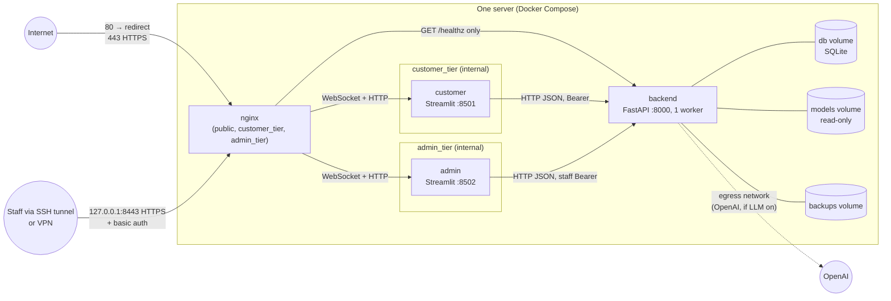

# Deployment architecture: single server, Docker Compose (Stage 13)

The design for running the chatbot on one Linux server with Docker Compose: Nginx in
front of the FastAPI backend, the customer Streamlit page and the staff Streamlit
dashboard. The files are in [deploy/](../deploy/):

| File | Purpose |
|---|---|
| [deploy/compose.yaml](../deploy/compose.yaml) | Services, networks, volumes, hardening |
| [deploy/Dockerfile](../deploy/Dockerfile) | Three images, `backend`, `customer` and `admin`, from one shared base stage ([section 13](#13-images)) |
| `deploy/requirements/backend.txt`, `frontend.txt` | Hash-locked dependency sets for the images, generated by [scripts/lock_deploy_requirements.py](../scripts/lock_deploy_requirements.py) |
| [deploy/nginx/nginx.conf](../deploy/nginx/nginx.conf) | TLS, routing, per-visitor limits, staff access |
| [deploy/.env.example](../deploy/.env.example) | Compose variables: environment, ports, model revision |
| `deploy/environments/<env>/*.env.example` | Application settings per environment (`production`, `staging`) |
| [.dockerignore](../.dockerignore) | Allow-list of what enters the build |
| [tests/test_deployment_config.py](../tests/test_deployment_config.py) | Checks of the properties below (36 tests) |

> **Status: designed and statically checked, not yet built or run.** Docker is not
> installed on the development machine, so no image has been built and no container
> has started. [Section 11](#11-verification) lists what was checked and what must be
> checked on a Docker host before relying on it. Even when the containers run, this
> architecture does not by itself make the application production-ready.
> [docs/deployment-readiness.md](deployment-readiness.md) still has blockers this design
> does not address (staff identity, monitoring, scheduled backups).

## Contents

1. [Overview](#1-overview)
2. [Networks](#2-networks)
3. [Traffic flows](#3-traffic-flows)
4. [Staff access restriction](#4-staff-access-restriction)
5. [Persistent storage](#5-persistent-storage)
6. [Environment-specific configuration](#6-environment-specific-configuration)
7. [Container hardening](#7-container-hardening)
8. [Rate limiting behind the proxy](#8-rate-limiting-behind-the-proxy)
9. [Redis and PostgreSQL: assessment](#9-redis-and-postgresql-assessment)
10. [First deployment](#10-first-deployment)
11. [Verification](#11-verification)
12. [What this does and does not change in the readiness assessment](#12-what-this-does-and-does-not-change-in-the-readiness-assessment)
13. [Images](#13-images)

---

## 1. Overview



| Service | Image | Listens on | Published | Notes |
|---|---|---|---|---|
| `nginx` | `nginxinc/nginx-unprivileged:1.30.6-alpine`, pinned by digest | 8080, 8443, 9443 | 80, 443 on all interfaces; 8443 on 127.0.0.1 | Only service with published ports |
| `backend` | `support-chatbot-backend` (`deploy/Dockerfile`, target `backend`) | 8000 | No | One uvicorn worker, `--no-server-header` |
| `customer` | `support-chatbot-customer` (target `customer`) | 8501 | No | `frontend/app.py` |
| `admin` | `support-chatbot-admin` (target `admin`) | 8502 | No | `frontend/admin_app.py` |
| `model-init` | backend image | none | No | One-off (profile `setup`): fetches the pinned model |

Service names are fixed in the Compose file (`name: support-chatbot`), so containers,
networks and volumes are always `support-chatbot-<name>`, and services find each other
by name (`http://backend:8000`).

No Kubernetes, Redis or PostgreSQL is introduced ([section 9](#9-redis-and-postgresql-assessment)).

## 2. Networks

| Network | Internal | Members | Purpose |
|---|---|---|---|
| `public` | No | `nginx` | Carries the published ports |
| `customer_tier` | **Yes** | `nginx`, `customer`, `backend` | Customer page traffic |
| `admin_tier` | **Yes** | `nginx`, `admin`, `backend` | Staff dashboard traffic |
| `egress` | No | `backend`, `model-init` | Outbound only: OpenAI (when `LLM_ENABLED=true`) and the one-off model download. Nothing is published on it |

- **The backend is never published** and is not on `public`. From outside the server
  it can only be reached through what Nginx proxies, which is `GET /healthz` alone.
- **Streamlit ports are never published.** 8501 and 8502 exist only on the internal
  networks.
- **The two pages share no network.** A compromised customer container cannot open
  the staff dashboard's port, and the reverse holds too.
- Internal networks have **no route to the internet**, so neither Streamlit container
  can make outbound connections.
- The backend keeps `egress` even with the LLM off. To remove its internet access
  entirely in that case, drop `egress` from the backend in a Compose override file.

## 3. Traffic flows

| Flow | Path |
|---|---|
| Customer chat | Browser → `nginx:8443` (TLS) → `customer:8501` (HTTP and the `/_stcore/stream` WebSocket) → `backend:8000` (server-side HTTP with the conversation token) |
| Staff dashboard | Browser → SSH tunnel or VPN → `nginx:9443` (TLS + basic auth) → `admin:8502` → `backend:8000` (staff token) |
| Uptime monitoring | Monitor → `nginx:8443/healthz` → `backend:8000/api/v1/ready` (200 when the knowledge base and storage are usable, 503 otherwise) |
| HTTP | `nginx:8080` answers with a `308` redirect to HTTPS |
| Outbound | `backend` → OpenAI over `egress`, only when the LLM is enabled |

**Why the API is not exposed:** the browser talks only to Streamlit, and Streamlit calls
the API server-side ([docs/integration-guide.md](integration-guide.md)). No current
client needs the API from the internet. Exposing it later for an external client
([docs/chat-api.md](chat-api.md)) would need an Nginx route allow-list. Customer and
staff ticket routes share `/support/tickets`, so it cannot be done by prefix. It would
also need `CORS_ORIGINS` and trusted forwarded headers. Not done here.

Traffic between Streamlit and the backend is plain HTTP on a Docker bridge that never
leaves the server. The frontend logs its standard warning for `http://` to a
non-loopback host (`frontend/config.py`); here that warning is expected.

## 4. Staff access restriction

Three independent layers, each of which must be passed:

1. **Network:** the dashboard listener is published on `127.0.0.1:8443` by default
   (`ADMIN_BIND`). Staff reach it through an SSH tunnel
   (`ssh -L 8443:127.0.0.1:8443 user@server`, then `https://localhost:8443`) or a VPN
   address set in `ADMIN_BIND`. An optional `allow`/`deny` list is in `nginx.conf`.
2. **HTTP basic authentication** at Nginx (`deploy/nginx/admin.htpasswd`). This is a
   credential separate from the staff token. It also stops anonymous visitors from
   reaching the Streamlit app at all.
3. **The staff bearer token** checked by the backend, with roles
   ([docs/admin-dashboard.md](admin-dashboard.md)).

The staff API (`/api/v1/admin/*`, ticket status changes) is unreachable from outside:
only the admin container calls it, over `admin_tier`. API documentation (`/docs`) is
off in production (`APP_ENV=production`) and not proxied in any environment.

This restricts **where** staff can connect from. It does not fix the staff identity
model (static tokens, no MFA, revocation needs a restart: SEC-08). A tunnel or VPN plus
basic auth makes a leaked token much harder to use, but the token is still the final
credential.

## 5. Persistent storage

| Volume | Mounted at | Holds | Notes |
|---|---|---|---|
| `db` | `backend:/var/lib/chatbot` | `conversations.db` and its WAL files: conversations, tickets, contacts, **FAQs** (since Stage 11), audit log | `DATABASE_URL=sqlite:////var/lib/chatbot/conversations.db`, fixed in `compose.yaml` |
| `backups` | `backend:/app/data/backups` | Copies made by `scripts.import_faqs --backup` | Copy off the server; holds customer data unencrypted |
| `models` | `backend:/models` **read-only**; `model-init:/models` read-write | The embedding model folder `all-MiniLM-L6-v2` | Written once by `model-init` |

**Required application data.** The FAQ knowledge base lives in the database, so it is
covered by `db`. The FAQ seed file `data/faqs.json` is built into the backend image
(`FAQ_DATA_PATH=/app/data/faqs.json`). It is read only to fill an empty FAQ table on the
first start, and it is versioned with the code. No other runtime data exists:
evaluation files are excluded from the images.

**Model cache.** The backend loads the model from a plain folder
(`EMBEDDING_MODEL_NAME=/models/all-MiniLM-L6-v2`) with `HF_HUB_OFFLINE=1`, so it never
contacts Hugging Face. `model-init` downloads revision
`1110a243fdf4706b3f48f1d95db1a4f5529b4d41`, the revision in the local cache that every
Stage 12 evaluation used. This closes the "model revision not pinned" limitation in
the readiness assessment. Loading that revision from a plain folder gives vectors
identical to loading it by name (maximum difference 0.0, checked on 2026-10-19). If
the model is missing, the backend still serves keyword-only answers, and
`/api/v1/ready` reports `semantic_search: unavailable`.

**Not persisted, by design:** Streamlit session state (in memory). Restarting the
`customer` container ends open chats in the page. The conversations stay in the
database, but the page loses their tokens, so customers start a new conversation.
Rate-limit counters and the LLM circuit breaker also reset on a backend restart.

Volume directories are created in the image and owned by the app user (uid 10001), so
new named volumes are writable by the non-root process without any `chown` at runtime.

## 6. Environment-specific configuration

Two levels, both kept out of git:

| File | Read by | Contents |
|---|---|---|
| `deploy/.env` (from `.env.example`) | Docker Compose | `DEPLOY_ENV`, published addresses and ports, image tag, model revision |
| `deploy/environments/<DEPLOY_ENV>/backend.env` | `backend` | Application settings: `APP_ENV`, rate limits, staff hashes, LLM switch and key |
| `deploy/environments/<DEPLOY_ENV>/customer.env` | `customer` | Page settings: demo notice, example questions, timeouts |
| `deploy/environments/<DEPLOY_ENV>/admin.env` | `admin` | Dashboard session limits, timeouts |

- `DEPLOY_ENV` selects the folder: `production` and `staging` are provided. Staging
  uses `APP_ENV=staging`, the demo notice and lower site-wide limits. Compose refuses
  to start if `DEPLOY_ENV` is unset.
- **Paths and wiring are fixed in `compose.yaml`**, not in the environment files:
  `DATABASE_URL`, `FAQ_DATA_PATH`, `EMBEDDING_MODEL_NAME`, `HF_HUB_OFFLINE` and
  `BACKEND_API_URL`. An environment file cannot point the backend at another database
  or the pages at another backend.
- Running Compose from `deploy/` means it reads `deploy/.env`, never the project
  root's development `.env`. The root `.env` is also excluded from the build context,
  so it can never end up inside an image, where `Settings` would load it.
- Every example validates against the application's settings classes
  (`test_backend_environment_files_are_valid_settings`,
  `test_page_environment_files_are_valid_settings`). The application itself still
  refuses invalid values at startup (verified in
  [docs/deployment-readiness.md §4](deployment-readiness.md#4-verification-performed-for-this-assessment)).
- Secrets (`OPENAI_API_KEY`, `STAFF_TOKEN_HASHES`) live in `backend.env`, readable only
  by the deploying user (`chmod 600`). No secrets manager is used. Compose `secrets:`
  would need code changes, because the settings read environment variables only.

## 7. Container hardening

Applied to every service through the `x-hardening` block in `compose.yaml`, and
enforced by `test_every_service_is_hardened`:

| Control | Setting |
|---|---|
| No privileged containers | No `privileged`; no host network, PID or IPC namespace |
| No Docker socket | No container mounts `/var/run/docker.sock` or any host system path (`test_no_container_mounts_the_docker_socket_or_host_system_paths`) |
| No Linux capabilities | `cap_drop: [ALL]`, no `cap_add`. Nginx uses the unprivileged image and ports above 1024, so it needs no `NET_BIND_SERVICE` |
| No privilege escalation | `no-new-privileges:true` |
| Non-root | App images run as uid 10001; Nginx as uid 101 |
| Read-only root filesystem | `read_only: true`; writable paths are the named volumes and a size-limited tmpfs at `/tmp` |
| Resource limits | Memory: backend 2 GB (measured ~0.6 GB warm), pages 512 MB, Nginx 128 MB. CPU limits; `pids_limit: 256` |
| Log size | `json-file` driver, 10 MB × 5 files per container |
| Minimal images | Frontend image has no AI packages; backend excludes Streamlit and development tools; build context is an allow-list |

Base images are pinned by exact version **and** digest: Python 3.13.16 on Debian 13
(`python:3.13.16-slim-trixie@sha256:…`) and Nginx 1.30.6
(`nginxinc/nginx-unprivileged:1.30.6-alpine@sha256:…`). No image uses `latest`
([section 13](#13-images)).

## 8. Rate limiting behind the proxy

**Finding (from reading the code, not observed in a running deployment):** the backend
keys its per-IP limits on the TCP peer address (`app/api/dependencies.py`), and the
frontend does not forward the visitor's address. Behind Streamlit, every customer
reaches the backend from the `customer` container's address. Under the default limits,
**20 new conversations per minute and 120 requests per minute would apply to all
customers together**. This is already true in the development setup; it matters once
there is real traffic.

The design handles it without code changes:

- **Per visitor at Nginx** (the real client address): 10 requests per second (burst
  40), **20 new Streamlit sessions per minute** (each starts one conversation), and at
  most 20 open connections per address.
- **Site-wide ceilings in the backend:** `backend.env.example` raises the per-IP
  limits to 3,000 requests and 300 new conversations per minute in production (600 and
  60 in staging). Behind the page these act as a whole-site safety valve. Size them to
  expected traffic.
- **Unchanged and still per customer:** chat messages (20 per minute) and support
  requests (5 per minute) are keyed by conversation and token, not by address.

What Nginx cannot limit: messages inside an open WebSocket. That is what the
per-conversation chat limit in the backend covers. A future code change could have the
pages forward the visitor's address, with the backend trusting it only from the page
containers. That would make the backend's own per-IP limits per visitor again. It is
recommended, not done here.

## 9. Redis and PostgreSQL: assessment

The task allows Redis or PostgreSQL only for a verified blocker in the existing
implementation. The verified findings were checked against this architecture:

| Finding | Verified where | Blocks this architecture? | Decision |
|---|---|---|---|
| SEC-09: rate limits are per process | Security audit | **No.** It blocks *several* backend processes. This design runs exactly one (`--workers 1`, one service, no replicas; `test_backend_runs_exactly_one_worker`) | No Redis |
| SEC-10: FAQ catalogue and semantic index are per process; other workers serve stale FAQs after an edit | Security audit | **No**, for the same reason | No Redis |
| SQLite allows one writer; chat p99 7.1 s at 8 parallel conversations, 0 errors | Load test (test report) | **No.** It is a capacity limit, not a failure at measured load. Writers wait up to 5 s, then get `503` with `Retry-After` | No PostgreSQL now |
| SQLite cannot be shared by several servers | Security audit §7 | **No.** This is a single-server design | No PostgreSQL |
| Per-IP limits see the page container ([section 8](#8-rate-limiting-behind-the-proxy)) | Code reading (this design) | **No.** Handled at Nginx | No Redis |

**Conclusion: no verified blocker requires Redis or PostgreSQL for a single-server,
single-worker deployment.** None is introduced.

**Recommendation for later**, before any change of architecture: move to PostgreSQL,
and shared rate limits and catalogue revision (Redis or the database), when **any** of
these becomes true:

- more than one backend process or server is needed;
- `503` responses caused by the SQLite busy timeout appear in the logs under real
  traffic;
- chat p99 under real traffic exceeds an agreed target.

That move needs versioned migrations (the readiness assessment, "Database
migrations") and a load test of its own.

**Operating constraint that follows:** never scale the backend
(`docker compose up --scale backend=2`) or add `--workers`. Compose cannot forbid this;
the test and this document are the guard.

## 10. First deployment

On a Linux server with Docker Engine and the Compose plugin, from a checkout of the
repository:

```bash
cd deploy
cp .env.example .env                                   # set DEPLOY_ENV (production or staging)
for f in backend customer admin; do
  cp environments/production/$f.env.example environments/production/$f.env
done
chmod 600 environments/production/*.env                # then edit backend.env

# TLS: certificates from your CA or certbot (outside Compose), or self-signed for staging
mkdir -p nginx/certs
openssl req -x509 -newkey rsa:2048 -nodes -days 30 -subj "/CN=staging.example" \
  -keyout nginx/certs/privkey.pem -out nginx/certs/fullchain.pem      # staging only

# Staff basic-auth file (SHA-512 crypt; you are prompted for the password)
printf 'staff:%s\n' "$(openssl passwd -6)" > nginx/admin.htpasswd

# Nginx runs as uid/gid 101 and must be able to read the key and the password file
sudo chown root:101 nginx/certs/privkey.pem nginx/admin.htpasswd
sudo chmod 640 nginx/certs/privkey.pem nginx/admin.htpasswd

docker compose build
docker compose --profile setup run --rm model-init     # fetch the pinned model once

# Staff tokens: the printed entry goes into STAFF_TOKEN_HASHES in backend.env
docker compose run --rm --no-deps backend \
  python -m scripts.create_staff_token alice --role admin

docker compose up -d
docker compose ps                                      # all services "healthy"
curl -fsS https://<host>/healthz
```

Routine operations run inside the backend container, against the same database:

```bash
docker compose exec backend python -m scripts.cleanup_conversations
docker compose exec backend python -m scripts.anonymize_support_data --retention
```

These are not scheduled. There is no standalone backup command: the only code that
copies the database is `scripts.import_faqs --backup`, which also imports FAQs (and
skips the backup with `--dry-run`). Scheduled backups copied off the server are still
open (readiness assessment, "Backup and recovery").

## 11. Verification

**Checked on 2026-10-19 (development machine, no Docker):**

| Check | Result |
|---|---|
| `tests/test_deployment_config.py` | **36 passed**: hardening on every service, no Docker socket or host paths, only Nginx publishes ports, dashboard on loopback by default, internal networks and tier separation, one backend worker, named volumes and read-only model, pinned revision, every environment example validates against `Settings` / `FrontendSettings`, no secrets in examples, build-context allow-list, git-ignore rules, no backend route in Nginx except readiness, WebSocket header inheritance; and for the images: stage layout, digest-pinned base images, hash-locked installs only, every locked package hashed, locks agreeing with `requirements.txt`, CPU-only PyTorch, no development tools, non-root user, exec-form commands, three health checks, offline model; required `.dockerignore` exclusions present, and none of them matching application, schema or FAQ files |
| Tests detect regressions | Five deliberate breakages each failed exactly one test (a `privileged` service, the customer page joining `admin_tier`, a WebSocket location losing `Host`, an install without `--require-hashes`, an unpinned base image); files restored afterwards |
| Model from a plain folder | The cached revision `1110a243…` loaded from its folder gives embeddings identical to loading by name (max abs difference 0.0) |
| Command-line options | `uvicorn` 0.54 accepts `--workers`, `--no-server-header`, `--timeout-graceful-shutdown`; the Streamlit options used are standard server options |
| Git ignore | Real `*.env`, certificates and `admin.htpasswd` are ignored; the `*.env.example` files are tracked. (The folder is `environments/`, not `env/`, because the virtualenv rule `env/` would have ignored it whole.) |
| Lint | `ruff check` and `ruff format --check` pass on the new test file |

**Not verified: must be checked on a Docker host before relying on this design:**

1. `docker compose config` accepts the file (YAML merge keys with a list, `profiles`,
   `mem_limit` and `cpus` with the installed Compose version).
2. All three images build, and the frontend import check passes. (pip accepting the
   lock files with `--require-hashes` for Linux x86-64 *was* checked:
   [section 13](#13-images).)
3. Every container starts and turns healthy **with the read-only root filesystem**: the
   Nginx image's entrypoint scripts, Streamlit writing under `HOME=/tmp`, PyTorch and
   Hugging Face reading a read-only model folder.
4. `nginx -t` accepts the configuration, including `server ... resolve` in upstreams
   (open-source Nginx 1.27.3 or later; the image is 1.30.6) and `http2 on`.
5. Streamlit works through the proxy: the WebSocket upgrades, the XSRF check passes
   over HTTPS, and sessions survive the 1-hour proxy read timeout with Streamlit's
   keep-alive.
6. Basic auth accepts an `openssl passwd -6` hash on the Alpine image, and the browser
   sends it on the WebSocket upgrade.
7. From outside the server: only 80 and 443 answer; 8000, 8501 and 8502 do not; the
   dashboard port answers only on the server's loopback (`ss -tlnp` and an external
   port scan).
8. Per-visitor Nginx limits return `429` as configured, and the site-wide backend
   ceilings are not hit by normal traffic.
9. `model-init` writes a folder the backend loads, with `/api/v1/ready` then reporting
   `semantic_search: ready` after the background preload.
10. Restart behaviour: `docker compose restart backend` keeps data and recovers;
    `docker compose down` followed by `up` keeps all volumes.

## 12. What this does and does not change in the readiness assessment

| Readiness category | Effect of this design |
|---|---|
| Security | **Addresses** TLS termination, HSTS, proxy timeouts and request limits, frame protection for the Streamlit pages, the `server` header, and keeping `/docs` and `/admin` off the internet. **Still open:** a Streamlit-specific CSP, SEC-08, a deployed-instance scan, and building and running this design |
| Authentication | **Reduces exposure** (tunnel or VPN plus basic auth before the staff token). Does **not** fix SEC-08 |
| AI model initialization | **Addresses** the unpinned revision and runtime downloads (pinned folder, offline) |
| Resource consumption | **Adds** per-visitor limits, connection limits and proxy timeouts at Nginx, and container memory, CPU and PID limits |
| Operational documentation | **Adds** a deployment procedure for this target (section 10). A runbook is still missing |
| Monitoring | **Adds** a public readiness URL for an uptime monitor. Metrics and alerting are still missing |
| Backup and recovery | **Unchanged:** volumes make the data location explicit, but nothing backs them up |
| Data persistence, migrations, performance | **Unchanged:** still one SQLite file, one writer, implicit upgrades at start |

The readiness results stay as they are until this design has been built, run and
verified on a Docker host (section 11).

## 13. Images

One Dockerfile, [deploy/Dockerfile](../deploy/Dockerfile), with three targets:

```
base ──┬── backend    FastAPI + embedding stack + maintenance scripts      :8000
       └── frontend ──┬── customer   frontend/app.py                        :8501
                      └── admin      frontend/admin_app.py                  :8502
```

`customer` and `admin` share every layer and differ only in command, port and health
check, so the second image costs no extra disk or build time. Separate Dockerfiles
would duplicate the dependency steps for no benefit.

### Requirements and how they are met

| Requirement | How |
|---|---|
| Supported Python | CPython **3.13.16** (`python:3.13.16-slim-trixie`, Debian 13). Python 3.13 receives security fixes until 2029. The development and test environment is 3.13.3, the same minor version |
| Pinned dependencies | Every Python package, transitive ones included, is pinned to an exact version with SHA-256 hashes in `deploy/requirements/backend.txt` (68 packages) and `frontend.txt` (42) |
| Reproducible installation | Base image pinned by **digest**. `pip install --require-hashes --no-deps --only-binary=:all:` from the lock files: pip resolves nothing, accepts only files with a listed hash, and builds nothing from source |
| Non-root user | `app` (uid/gid 10001), `USER app` in every runtime stage |
| No `.env`, databases or virtual environments | [.dockerignore](../.dockerignore) has two layers. An allow-list sends only `app/`, `frontend/`, `scripts/`, `data/faqs.json`, `.streamlit/config.toml` and `deploy/requirements/`. Explicit exclusions after it (environment files, credentials, virtual environments, `.git`, SQLite files and journals, backups and archives, caches, test and coverage reports, logs, temporary and editor files) apply **even inside those folders**. Schema code (`app/database/`) and the maintenance scripts stay in. See [Build context](#build-context) |
| No development tools | pytest, pytest-cov, ruff and mypy are in neither lock. The frontend lock has no PyTorch, sentence-transformers or OpenAI; the backend lock has no Streamlit (`test_development_tools_are_in_neither_image`) |
| Working directory | `/app` |
| Startup commands | Exec-form `CMD`: uvicorn with one worker for the backend; `streamlit run` for each page (headless, no file watcher) |
| Health checks | `HEALTHCHECK` in all three images: backend `GET /api/v1/ready` (200 only when the knowledge base and storage are usable); pages `GET /_stcore/health`. Compose relies on them for start order |
| SIGTERM and graceful shutdown | See [Shutdown](#shutdown) |
| No repeated model downloads | See [Model caching](#model-caching) |
| No `latest` tags | Python and Nginx are referenced by exact version and digest (`test_base_and_proxy_images_are_pinned_by_version_and_digest`) |

### Build context

Checked on 2026-10-19 with docker-py 7.2.0's `exclude_paths`, the Docker SDK's
implementation of the `.dockerignore` rules (installed in a scratch environment, not
the project):

| Check | Result |
|---|---|
| Real project tree | **133 files**: `app/` 79 (including `app/database/connection.py` and `models.py`, the schema code), `frontend/` 24, `scripts/` 25, `data/faqs.json`, `.streamlit/config.toml`, both lock files, and `.dockerignore` itself (always sent). No cache, database, environment or credential file, although `__pycache__` folders exist in `app/` |
| Decoys planted in a copy | 43 decoys (`app/.env`, `frontend/.env.local`, `scripts/secrets/`, `.streamlit/secrets.toml`, `*.pem`, `*.key`, `*.htpasswd`, `app/test.db`, `*.db-wal`, `scripts/backups/`, `*.bak`, `*.zip`, `*.tar.gz`, `.pytest_cache`, `.coverage`, `coverage.xml`, `htmlcov/`, `junit-*.xml`, `.mypy_cache`, `.ruff_cache`, logs, `*.tmp`, `*.swp`, `*~`, `.vscode/`, `.idea/`, `.DS_Store`, nested `.venv/`, `venv/` and `.git/`, `*.egg-info`, plus root `.env`, `.venv`, `.git`, `data/conversations.db`, `data/backups/`, `deploy/environments/*/backend.env`, `deploy/nginx/certs/`): **none** reached the context, which stayed at the same 133 files |
| Same decoys, previous `.dockerignore` (allow-list only) | 33 of the 43 leaked: every decoy placed inside an allowed folder. This is what the explicit exclusions fix |

There are no separate migration files to protect: schema creation and upgrades run at
startup from `app/database/connection.py` (`init_schema`), with table definitions in
`app/database/models.py`. `test_no_exclusion_removes_application_code_schema_code_or_faq_data`
fails if any exclusion would match them, the FAQ seed or the maintenance scripts.

### Reproducibility: what is and is not pinned

| Component | Pinned? |
|---|---|
| Base OS and Python | **Yes**, by image digest `sha256:70729b46…`: the same bytes every build |
| pip (the installer) | **Yes**, as part of that image |
| Python packages, direct and transitive | **Yes**: exact versions and hashes, resolved for the target platform |
| PyTorch | **Yes**: `torch==2.14.1+cpu` with hashes, from PyTorch's CPU index. A file from either index is accepted only if its hash is in the lock |
| Embedding model | **Yes**: revision `1110a243…`, fetched by `model-init`, not baked in |
| Nginx | **Yes**: `1.30.6-alpine` by digest |
| Debian security updates | **No**, by design: they arrive only when the digest is bumped. Bump it regularly, because a pinned digest also freezes vulnerabilities |
| Platform | **linux/amd64 only.** The locks are resolved for x86-64; PyTorch's `+cpu` build differs on arm64 |

With these pins, two builds from the same commit install the same files. That was
**not demonstrated by building twice**: no Docker was available. Image *digests* would
still differ between builds, because layer timestamps are not normalised (no
`SOURCE_DATE_EPOCH`); the contents are what is pinned.

**Updating dependencies:** change a pin in `requirements.txt`, run
`python -m scripts.lock_deploy_requirements` (needs [uv](https://docs.astral.sh/uv/) and
network access), and commit both. uv is used because it resolves for the target
platform. pip, run on Windows, evaluates markers such as `sys_platform != "win32"` for
Windows and silently drops `uvloop`; that was observed in a trial run, so pip is not
used for locking. `test_locks_agree_with_the_direct_pins_in_requirements_txt` fails if
the two files drift apart.

**Updating the base image:** read the new digest, for example with
`docker buildx imagetools inspect python:3.13.N-slim-trixie`, and change the tag and
digest together in the `ARG PYTHON_IMAGE` line.

### Shutdown

- All commands are exec form, so the server process itself receives `SIGTERM` (Docker's
  default stop signal, also set with `STOPSIGNAL`). Compose adds `init: true` (tini) as
  PID 1, which forwards signals and reaps the health-check processes.
- **Backend:** uvicorn stops accepting connections, waits up to 20 s for running
  requests (`--timeout-graceful-shutdown 20`), then runs the application's shutdown,
  which closes the OpenAI client and disposes of the database connections. Compose
  allows 30 s (`stop_grace_period`) before `SIGKILL`. A chat turn still running after
  20 s (possible only with slow LLM calls) is cancelled. Its processing lease expires
  on its own (`CONVERSATION_PROCESSING_LEASE_SECONDS`), and nothing half-written is
  stored, because each exchange is written in one transaction.
- **Pages:** Streamlit handles `SIGTERM` and stops its server. Open browser sessions end;
  their conversations stay in the database ([section 5](#5-persistent-storage)).
- Not observed in a container (no Docker).

### Model caching

- **Never at startup, never baked in.** The backend image sets `HF_HUB_OFFLINE=1`,
  `TRANSFORMERS_OFFLINE=1` and `EMBEDDING_MODEL_NAME=/models/all-MiniLM-L6-v2`, so it
  loads the model from a local folder and makes no Hugging Face request, even when run
  outside Compose.
- **Downloaded once**, by `docker compose --profile setup run --rm model-init`, into the
  `models` volume at the pinned revision (about 90 MB). The volume survives image
  rebuilds and container restarts, so upgrades do not download again.
- **Mounted read-only** in the backend. The model is loaded into memory once per
  process, in the background after startup (`SEMANTIC_INDEX_PRELOAD=background`):
  22–160 s on the measured laptop.
- **If the volume is empty**, the backend still starts and is ready. Answers are
  keyword-only, and `/api/v1/ready` reports `semantic_search: unavailable` after the
  failed load. Load attempts are spaced by `EMBEDDING_LOAD_RETRY_SECONDS`, never
  repeated per request.
- **Why not bake the model into the image:** the backend image would grow by about
  90 MB on every rebuild and push, and changing the model would mean a rebuild. Baking
  it in suits a deployment that can only pull from a registry. It is a `COPY` from a
  build stage if needed.

### Image size and installation time

Measured on 2026-10-19 by installing each lock exactly as the Dockerfile does
(`--require-hashes --no-deps --only-binary=:all:`, Linux x86-64 wheels, PyPI plus the
PyTorch CPU index) into a scratch folder on the development machine. This also proves
that pip accepts both lock files. **No image was built**, so the image totals are
estimates: base, plus the measured packages, plus about 2 MB of application code.

| | Backend | Customer / admin |
|---|---|---|
| Packages | 68 | 42 |
| Download (wheels) | 309 MB | 118 MB |
| Largest downloads | torch 196 MB, scipy 35, numpy 17, transformers 13, scikit-learn 9 | pyarrow 54 MB, numpy 17, pydeck 11, pandas 11, streamlit 10 |
| Installed packages | **1,428 MB** | **455 MB** |
| Download and install time (this connection) | 788 s | 215 s |
| Base image (compressed download) | 43.1 MB | 43.1 MB (shared) |
| **Estimated image size (uncompressed)** | **≈ 1.55 GB** | **≈ 0.58 GB** (one set of layers for both pages) |

**Reading these numbers:**

- **PyTorch dominates the backend**: about two thirds of its download. The CPU-only
  wheel is already the small option; the default PyPI build would add several GB of
  CUDA libraries (`nvidia-*`), which the lock excludes
  (`test_backend_lock_has_cpu_only_torch_and_the_linux_server_extras`). scipy and
  scikit-learn come in through sentence-transformers and are not used directly.
  Removing them would mean a patched dependency tree, which was not done.
- **Streamlit brings pyarrow, pandas and numpy** (about 80 MB of the frontend
  download), although the pages do not use them directly. They are Streamlit's own
  requirements.
- **Times depend on the network.** The 788 s were mostly downloading on the
  development machine's connection (about 0.4 MB/s). A server with a fast connection
  downloads the same 309 MB in a fraction of that.
- **Rebuilds are cheap.** Dependencies are installed before the application code is
  copied, so a code change rebuilds only the last few megabytes. Only a lock-file
  change reinstalls the packages.
- **Runtime memory** is separate from image size: about 0.6 GB for the backend once
  the model is loaded ([docs/test-and-quality-report.md](test-and-quality-report.md)).
