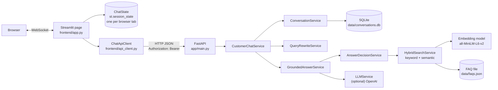
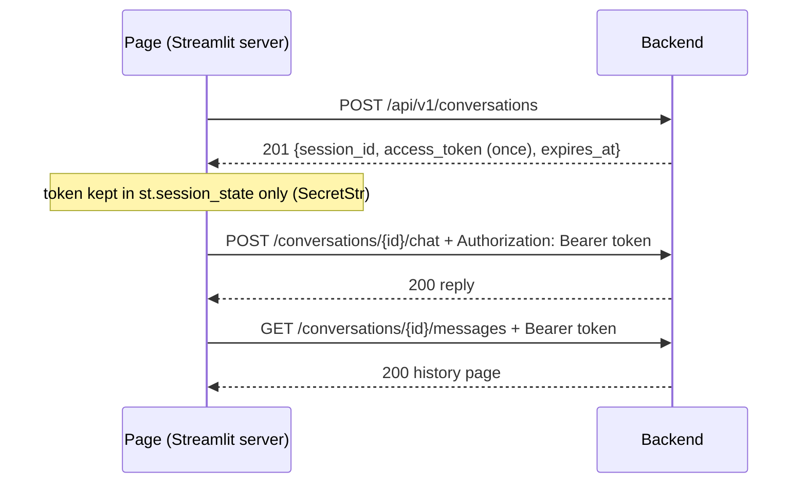

# Integration guide: frontend and backend (Stage 9)

For developers working on, or integrating with, the FastAPI backend and the Streamlit frontend. It explains how the two fit together, how to run them, and how they are tested. Details live in focused documents, linked where relevant:

| Document | For |
|----------|-----|
| [chat-api.md](chat-api.md) | Writing a client of the chat API (the contract, with PowerShell and JavaScript examples) |
| [integration-compatibility.md](integration-compatibility.md) | The audit of the frontend against the backend, field by field |
| [performance-and-evaluation.md](performance-and-evaluation.md) | Measured timings and the customer-journey evaluation |
| [demo-guide.md](demo-guide.md) | Showing the application to a client |
| [../frontend/README.md](../frontend/README.md) | The Streamlit page: states, errors, session limits |

## 1. Architecture



- **Two processes.** The backend (`uvicorn app.main:app`, port 8000) owns the FAQs, the embedding model, the optional OpenAI key and the conversation database. The frontend (`streamlit run frontend/app.py`, port 8501) owns none of these. It never imports `app/` (a test enforces this) and talks to the backend over HTTP only.
- **Server to server.** Streamlit runs the page's Python on its server, so API calls go from the Streamlit server to the backend. The browser never sees the API or the token, and no CORS entry is needed.
- **The contract is shared, not the code.** The frontend has its own small response models. `tests/test_frontend_contract.py` checks them against the backend's models, routes and error codes.
- **Answers are grounded.** Retrieval and the answer decision decide whether to answer at all. The LLM (off by default) may only reword an approved FAQ answer, and every reworded reply is validated. On any failure the approved text is used.

## 2. Request flow of one chat message

1. The customer submits a message. The page checks it (not blank, at most `MAX_MESSAGE_CHARACTERS`, no control characters), gives it a new `client_message_id` (UUID4), shows it as pending and disables the input.
2. In the same run, `ChatApiClient.send_message` sends `POST /api/v1/conversations/{session_id}/chat` with `Authorization: Bearer <token>` and `{"message", "client_message_id"}`.
3. The backend:
   1. validates the body;
   2. returns the stored reply if this `client_message_id` was answered before (idempotent replay);
   3. checks the token and takes the conversation's processing lease (one message at a time);
   4. loads recent history and rewrites a follow-up into a standalone query;
   5. runs keyword and semantic retrieval, then the answer decision;
   6. optionally rewords the approved answer with the LLM and validates the result;
   7. stores the message and reply together, and logs one `event=conversation_turn` line with stage timings.
4. The page records the reply under the backend's `message_id`, marks the customer message as sent, and reruns to show it with its sources.
5. On failure, the page shows a message chosen by error kind, with the request ID as a reference. A failure that might have been stored keeps the message pending with the same ID, for **Try again**.

Measured on the development machine (LLM off, model loaded): about 50 ms per turn, about half of it the query embedding. The first turn after a start without preloading also loads the model (22–88 s). See [performance-and-evaluation.md](performance-and-evaluation.md).

## 3. Environment variables

Both processes read real environment variables first, then `.env` in the **project root** (found from the code's location, not the current directory). Copy `.env.example` to `.env`. **Nothing is required**: the defaults run the backend on `127.0.0.1:8000` with the LLM off and the frontend pointed at it. Secrets (`OPENAI_API_KEY`) belong only in `.env` or the environment. `.env` is git-ignored.

| Variable | Default | Process | Purpose |
|----------|---------|---------|---------|
| `APP_ENV` | `development` | backend | `production` turns off `/docs` and requires `https://` CORS origins |
| `FAQ_DATA_PATH` | `data/faqs.json` | backend | The knowledge base |
| `DATABASE_URL` | `sqlite:///data/conversations.db` | backend | Conversation storage (SQLite only) |
| `CONVERSATION_TTL_MINUTES` | `60` | backend | When a conversation stops accepting messages |
| `MAX_CUSTOMER_MESSAGE_CHARACTERS` | `4000` | backend | Longest message |
| `SEMANTIC_INDEX_PRELOAD` | `false` | backend | `true`: load the model before serving; `background`: while serving |
| `LLM_ENABLED` | `false` | backend | Let OpenAI reword approved answers (paid) |
| `OPENAI_API_KEY` | (none) | backend | Required when `LLM_ENABLED=true`. Secret |
| `RATE_LIMIT_*` | enabled | backend | Process-local limits per IP and per conversation |
| `BACKEND_API_URL` | `http://127.0.0.1:8000` | frontend | Where the backend is |
| `BACKEND_API_PREFIX` | `/api/v1` | frontend | Must equal the backend's `API_V1_PREFIX` |
| `BACKEND_READ_TIMEOUT_SECONDS` | `60` | frontend | How long to wait for a reply |
| `MAX_MESSAGE_CHARACTERS` | `4000` | frontend | Keep equal to the backend's limit |
| `EXAMPLE_QUESTIONS` | 3 questions | frontend | One-click questions (JSON list) |
| `DEMO_MODE` | `false` | frontend | The demo notice (see [demo-guide.md](demo-guide.md)) |

The full list with ranges is in `.env.example` and the main README's [Configuration](../README.md#configuration). Invalid values stop the backend with one line per variable (names, never values), and the page names invalid frontend variables the same way. `python scripts/check_setup.py` checks both without starting anything.

## 4. Starting locally (Windows PowerShell)

From the project root, with the virtual environment created (`py -3.13 -m venv .venv`, `pip install -r requirements.txt`):

```powershell
# Terminal 1: the backend
.\.venv\Scripts\Activate.ps1
$env:SEMANTIC_INDEX_PRELOAD = "true"    # or "background"; optional
uvicorn app.main:app --reload --host 127.0.0.1 --port 8000

# Terminal 2: the frontend
.\.venv\Scripts\Activate.ps1
streamlit run frontend/app.py           # http://localhost:8501
```

Or both in their own windows: `.\scripts\start-dev.ps1`. It checks the setup, refuses ports already in use, and waits for the backend's readiness before starting the frontend. For a client demo: `.\scripts\start-demo.ps1`.

Readiness: `GET /api/v1/health` says the process is alive. `GET /api/v1/ready` says chat requests can be answered (`200`, or `503` with the checks), and reports whether the search model is loaded and whether the LLM is enabled, without loading or calling either.

## 5. Session authorization



- The token is returned **once** and stored on the backend only as a SHA-256 hash. It goes only in the `Authorization` header: a token in a URL is refused with `400`.
- No header gives `401 UNAUTHORIZED_SESSION`. A wrong token, an unknown session and another visitor's session all give the same `404 SESSION_NOT_FOUND`, so nobody can probe for sessions.
- An expired conversation gives `410` (only `DELETE` still works). A closed one refuses new messages (`409 SESSION_CLOSED`) but stays readable.
- **A lost token can't be recovered.** A browser reload loses `st.session_state`, so the page starts a new conversation. The old one stays on the backend, unreachable, until it expires. See [What survives a lost browser session](../frontend/README.md#what-survives-a-lost-browser-session).

## 6. Chat request and response

```http
POST /api/v1/conversations/3f2b8c1e-7a4d-4e9b-9c61-2d5f0a8e4b17/chat
Authorization: Bearer cst_...
Content-Type: application/json

{"message": "What is your return policy?", "client_message_id": "4c981eb1-7847-41c0-bf6b-0a0e1b9d6d91"}
```

```json
{
  "session_id": "3f2b8c1e-7a4d-4e9b-9c61-2d5f0a8e4b17",
  "message_id": "b7d13f08-62ac-4f5e-a9d4-81e6c3b2f950",
  "client_message_id": "4c981eb1-7847-41c0-bf6b-0a0e1b9d6d91",
  "request_id": "6f1c0e3a9b2d4c7e8a5f1b3d2c4e6a8b",
  "decision": "answered",
  "answer": "You can return most items within 30 days of delivery, as long as they are unused, ...",
  "generation_method": "approved_faq",
  "sources": [{"faq_id": "faq_018", "question": "What is your return policy?"}],
  "usage": null,
  "created_at": "2026-10-16T09:30:06.123456Z",
  "user_message": {"...": "deprecated Stage 6 shape"},
  "assistant_message": {"...": "deprecated Stage 6 shape"}
}
```

- `decision` is one of `answered`, `ambiguous` (a clarifying question; `sources` are the offered FAQs), `no_match` (a safe fallback, no sources) or `retrieval_unavailable` (search is temporarily down, no sources). The last three are normal `200` replies, not errors.
- `generation_method` says how the text was produced: `approved_faq` (verbatim), `llm_grounded` (reworded and validated), `clarification` or `fallback`. Show it: the page labels every reply.
- Timestamps are ISO 8601 in UTC with `Z`. A client should reject timestamps without an offset; the Streamlit client does.
- History: `GET /api/v1/conversations/{id}/messages?offset=0&limit=100`, oldest first, with `has_more`. Customer messages carry their `client_message_id`, and replies carry `sources` with approved questions.

The complete contract, with every field, is in [chat-api.md](chat-api.md).

## 7. Error handling

Every error body is `{"error": {"code", "message", "request_id", "details"?}}`. The request ID is also in the `X-Request-ID` header and on every server log line. The page never shows `message`: it chooses its own wording by kind, and shows the request ID as "Reference: …".

| Status, code | Page shows | Way forward |
|--------------|-----------|-------------|
| No connection | "We can't reach the support service right now." | **Try again** |
| Timeout, `504` from a proxy | "This is taking longer than expected." | **Try again**, same ID |
| `422 VALIDATION_ERROR`, `413` | The specific problem (e.g. too long, at most N characters) | Edit; the text is back in the box |
| `401`, `403`, `404 SESSION_NOT_FOUND` | "This conversation is no longer available." | **Start a new conversation**, message kept |
| `410 SESSION_EXPIRED` | "This conversation has expired." | **Start a new conversation**, message kept |
| `409 SESSION_CLOSED` | "This conversation has ended." | **Start a new conversation** |
| `409 REQUEST_IN_PROGRESS` | "Your previous message is still being answered." | Retried automatically; then **Try again** |
| `429 RATE_LIMITED` | "…a little too quickly… about N s." | **Try again** after the wait |
| `503 SERVICE_UNAVAILABLE` | "Temporarily unavailable." | **Try again** |
| `500 INTERNAL_ERROR` | "Something went wrong on our side." | The message is back in the box |
| `200 retrieval_unavailable` | The backend's own message, "Reference: …" | **Ask again** |
| `200 no_match` | The backend's fallback message | Rephrase |

Diagnostics stay in the server log (an `event=api_error` line with the code and exception type). Bodies never contain SQL, paths, stack traces, prompts, keys or tokens; `tests/integration/test_error_handling.py` and `test_security.py` check this.

## 8. Idempotency

- One **logical message** has one `client_message_id`, created when it is submitted. Automatic retries, **Try again** and **Send again** all reuse it.
- The backend stores the ID with the message. A repeat with the same ID and text returns the stored reply (`Idempotent-Replayed: true`, `usage: null`) instead of answering again. The same ID with different text is `422 DUPLICATE_MESSAGE_CONFLICT`.
- While a message is being answered, other messages to the conversation get `409 REQUEST_IN_PROGRESS` with `Retry-After`. The frontend retries at most `BACKEND_MAX_RETRIES` times, and only for short waits, so there is no retry loop.
- **A timeout is not a failure.** The backend may have stored the reply. The page never assumes either way: **Try again** (same ID) returns the stored reply if there is one, and **Refresh messages** reconciles with the stored history.

## 9. Conversation persistence

- The backend's SQLite database is the record of what was saved. The message and its reply are written together or not at all.
- The page's message list is a view of that record plus what is not saved (yet). On **Refresh messages**, after an uncertain send and after a replay, it is reconciled by stable IDs: customer messages by `client_message_id`, replies by `message_id`. Customer messages the backend doesn't have are never dropped: they stay, marked, with **Send again**. The full rules are in [frontend/README.md](../frontend/README.md#conversation-history).
- Expired conversations are deleted at startup (`CONVERSATION_CLEANUP_ON_STARTUP`) or by `python scripts/cleanup_conversations.py`. **Delete conversation** removes one immediately.

## 10. Integration testing

```powershell
pytest                                 # everything: about 2.5 minutes
pytest tests/integration               # frontend + backend end to end, about 30 s
pytest (Get-ChildItem tests\test_frontend_*.py)    # the Streamlit frontend
python scripts/evaluate_integration.py --offline    # 32 customer journeys, real model
```

- `tests/integration/` runs the real FastAPI app (routes, storage in a temporary SQLite file, retrieval, decisions, validation) through the frontend's client or the page itself. The embedding model is replaced by a scripted encoder, OpenAI by a local stand-in that each test controls, and a fault injector can lose requests or replies. **No test downloads the model or calls OpenAI**; non-local network access fails the test.
- Files: `test_api_contract.py`, `test_conversation_workflow.py`, `test_reliability.py`, `test_security.py`, `test_error_handling.py`, `test_grounded_answers.py`.
- The Streamlit page is tested headless with `AppTest`. It has no browser, so layout, real clicks and reloads are **not** covered. See [frontend/README.md, Tests](../frontend/README.md#tests).
- `scripts/evaluate_integration.py` runs `data/integration_eval.json` with the real model: 28 of 32 journeys pass, and 4 are recorded retrieval-quality issues ([details](performance-and-evaluation.md#customer-journey-evaluation)).

## 11. Performance

| Measured (development machine, LLM off) | p50 |
|-----------------------------------------|----:|
| Warm chat request | 50 ms |
| Query embedding | 23 ms |
| Conversation storage, about 8 transactions | ~20 ms |
| Keyword search | 0.5 ms |
| Create a conversation | 9 ms |
| First request without preloading (model load) | 22–88 s, once |

Each chat turn logs `history_ms`, `rewrite_ms`, `pipeline_ms`, `store_ms` and `turn_ms` on its `event=conversation_turn` line (durations only). Run `python scripts/measure_performance.py --offline` to measure again. Live OpenAI latency has not been measured (it needs paid calls). Analysis and recommendations: [performance-and-evaluation.md](performance-and-evaluation.md).

## 12. Troubleshooting

| Symptom | Cause and fix |
|---------|---------------|
| Backend exits with `Cannot start: N invalid setting(s)` | Each line names a variable and the rule. Fix `.env` or the environment, or run `python scripts/check_setup.py` |
| Page shows `Invalid frontend settings …` | A frontend variable (e.g. `BACKEND_API_URL`) is invalid; the message names it |
| Sidebar **Unavailable** | Backend not running at `BACKEND_API_URL`, or `/ready` answers `503` (storage or knowledge base). Check the backend terminal |
| Sidebar **Online**, "first answer may take a little longer" | The model loads on the first question. Use `SEMANTIC_INDEX_PRELOAD=true` or `background` |
| First question times out | The model load took longer than `BACKEND_READ_TIMEOUT_SECONDS`. **Try again**: same ID, answered once |
| Every request is a `404 NOT_FOUND` "client error" | `BACKEND_API_PREFIX` differs from the backend's `API_V1_PREFIX` (`check_setup.py` reports it) |
| `409` with `Retry-After` | Another message to the same conversation is still being answered |
| `503` with `Retry-After: 1` | The SQLite file was locked by another writer; retry, and close tools holding it open |
| Port already in use | Another backend or frontend is running; `start-dev.ps1` reports it. Use other ports, and set `BACKEND_API_URL` for the frontend |
| Changes don't appear in the page | A Streamlit server started before the change may keep old modules: restart it |
| Answers are never "AI-written" | `LLM_ENABLED=false` (default), or the LLM is paused after errors: `/ready` shows `llm` |

More: the main README's [Troubleshooting](../README.md#troubleshooting).
